# El Plan · Cronograma de 32 Semanas (TG Robot UCAB)

> **Proyecto:** Robot móvil autónomo para búsqueda y transporte de componentes de laboratorio  
> **Autoras:** Iliana Semprun y Andrea Ferrer  
> **Tutor:** Ing. Biagio Cante  
> **Institución:** Universidad Católica Andrés Bello (UCAB) · Escuela de Telecomunicaciones  
> **Período:** 26 de octubre de 2026 al 11 de junio de 2027 (32 semanas)

---

## 📊 Diagrama Gantt del Proyecto

```mermaid
gantt
    title Cronograma de Trabajo de Grado (32 Semanas)
    dateFormat  YYYY-MM-DD
    axisFormat  %b %Y

    section Fase I: Levantamiento
    Revisión documental y requerimientos      :done, f1, 2026-10-26, 2026-11-20
    P01 (MQTT y Telemetría)                   :done, p01, 2026-11-02, 2026-11-14

    section Fase II: Diseño del Sistema
    Arquitectura MQTT, CAD y esquemáticos     :active, f2, 2026-11-23, 2026-12-18
    P03 (Control motor y Encoders)            :active, p03, 2026-11-23, 2026-12-05
    P08 (Seguidor de línea óptico)            :active, p08, 2026-12-01, 2026-12-18

    section Fase III: Construcción & Firmware
    Montaje físico y Firmware integrado       :f3, 2026-12-21, 2027-02-05
    Semana de Parciales (Avanzando ventaja)   :crit, sem_extra, 2027-01-11, 2027-01-16
    P07 (Firmware consolidado)                :p07, 2027-01-18, 2027-02-05

    section Fase IV: Navegación Progresiva
    Mapeo, odometría y filtro Kalman          :f4, 2027-02-08, 2027-03-12
    P04 (Re-localización BLE o QR)            :p04, 2027-02-15, 2027-03-12

    section Fase V: App Móvil & Backend
    Ventana de Oro (Dedicación intensiva)     :crit, v_oro, 2027-03-15, 2027-04-09
    App en Flutter y enlace Firebase          :f5, 2027-03-15, 2027-04-16
    P05/P06 (Firebase y app con pedidos)      :p06, 2027-03-22, 2027-04-16

    section Fase VI: Integración Total
    Alertas antirrobo y calibración física    :f6, 2027-04-19, 2027-05-07
    P11 en hardware (alertas al teléfono)     :p11, 2027-04-19, 2027-05-07

    section Fase VII: Pruebas & Tomo
    20+ ensayos en maqueta real               :f7, 2027-05-10, 2027-05-28
    Redacción final y defensa de TG           :f7_defensa, 2027-05-28, 2027-06-11
```

---

## 🗓️ Las 7 Fases en Detalle

| Fase | Período | Semanas | Objetivo Central | Hito Entregable |
| :--- | :--- | :---: | :--- | :--- |
| **I. Revisión y Levantamiento** | 26 oct – 20 nov 2026 | 1 a 4 | Levantamiento de requerimientos, entrevistas al personal técnico del laboratorio y orden de compra de hardware. | Documento de requerimientos y matriz de componentes seleccionados |
| **II. Diseño del Sistema** | 23 nov – 18 dic 2026 | 5 a 8 | Especificación de tópicos MQTT, diseño mecánico del chasis en CAD y modelado circuital del ESP32. | Planos de chasis, esquemáticos y arquitectura de red |
| **III. Construcción y Firmware** | 21 dic 2026 – 05 feb 2027 | 9 a 14 | Impresión 3D, ensamblaje de la plataforma motriz, lazo de control PD y cliente MQTT en ESP32. | Chasis ensamblado y primer firmware físico funcional |
| **IV. Navegación Progresiva** | 08 feb – 12 mar 2027 | 15 a 19 | Integración de odometría, estimación de postura con filtro de Kalman y re-localización en nodos de referencia. | Navegación autónoma validada con métricas de error |
| **V. App y Backend** | 15 mar – 16 abr 2027 | 20 a 24 | Desarrollo de la aplicación móvil en Flutter, persistencia en Firebase y gestión de solicitudes en tiempo real. | App cliente y panel de encargado 100% operativos |
| **VI. Integración y Alertas** | 19 abr – 07 may 2027 | 25 a 27 | Sincronización completa de hardware y software; validación del sistema antirrobo por acelerometría y rechazo de falsos positivos. | Prototipo integrado con protocolos de seguridad |
| **VII. Pruebas y Redacción Final** | 10 may – 11 jun 2027 | 28 a 32 | Campaña experimental en el laboratorio de la UCAB (≥ 20 repeticiones), análisis estadístico y defensa del tomo. | **Tomo final aprobado y defensa del Trabajo de Grado** |

---

## 🤖 Catálogo de Prototipos de Ingeniería (P01 a P13)

La lista oficial está en `datos/proyecto.js`. Estado al 18 nov 2026:

| Código | Prototipo | Estado |
| :--- | :--- | :--- |
| P01 | Así se hablan el robot y la app (MQTT, QoS, LWT < 22 s) | Hecho |
| P02 | Los sentidos del robot (4× TCRT5000 + 2× HC-SR04P) | En pruebas (simulación) |
| P03 | Motores que van parejo (JGA25-371, PWM 20 kHz, encoders) | En pruebas (simulación) |
| P04 | ¿BLE o QR? (re-localización) | Pendiente |
| P05 | Robot virtual y puente Firebase | Pendiente |
| P06 | Primera versión de la app con pedidos | Pendiente |
| P07 | El cerebro completo (`firmware/robot_integrado.ino`) | En pruebas (35 escenarios en PC; falta el ESP32 real) |
| P08 | Seguir la línea (PD a 100 Hz, simulador 3D) | En pruebas (simulación) |
| **P09** | **App Flutter Web con Modo Demo** (`app/`) | Hecho |
| **P10** | **Simulador ESP32 Virtual** (robot falso en el navegador) | Hecho |
| P11 | Centro de Alertas en la app (obstáculo, sensor sin eco, proximidad, batería) | En pruebas (simulación) |
| P12 | Analítica de sesión y reporte CSV | En pruebas (simulación) |
| P13 | Radar ultrasónico Frente/Atrás | En pruebas (simulación) |

**P09 ≠ P10:** P09 es la app que usa el operador; P10 es el ESP32 de mentira que le
habla por MQTT. Juntos son el **Gemelo Digital** para llegar a diciembre con el software
validado.

### Seguridad que ya está en el firmware y en el Gemelo Digital
- Obstáculo frontal < 20 cm: parada, alerta QoS 2, solo se permite retroceder con atrás ≥ 20 cm y sensor válido.
- Ultrasonido sin eco 500 ms: el sensor se marca en fallo y se bloquea esa dirección.
- Modo manual 5 s sin órdenes: el robot frena y se queda en manual (nunca pasa solo a autónomo).
- Batería ≤ 10,3 V: aviso preventivo; < 9,9 V: corte seguro.

### Cómo levantar el Gemelo Digital
1. `prototipos/P10-simulador-esp32/index.html` → **Encender ESP32 Virtual**.
2. App `https://ilianavsc.github.io/tg-robot-ucab/app/` → mismo broker → **Conectar**.
3. Panel **Inyección de Eventos / Pruebas HIL** del P10 → mirar el banner P11 y la tarjeta P12 en la app.

---

## 🌐 Ver en la Web Interactiva
Para explorar la versión gráfica dinámica con selector temporal en vivo, abre:  
👉 **[Cronograma Web Interactivo (32 semanas)](cronograma.html)**
