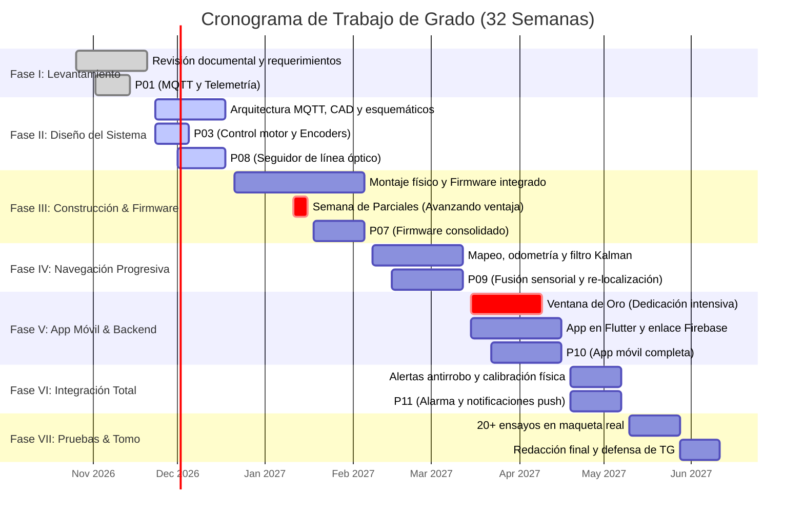

# El Plan · Cronograma de 32 Semanas (TG Robot UCAB)

> **Proyecto:** Robot móvil autónomo para búsqueda y transporte de componentes de laboratorio  
> **Autoras:** Iliana Semprun y Andrea Ferrer  
> **Tutor:** Ing. Biagio Cante  
> **Institución:** Universidad Católica Andrés Bello (UCAB) · Escuela de Telecomunicaciones  
> **Período:** 26 de octubre de 2026 al 11 de junio de 2027 (32 semanas)

---

## 📊 Diagrama Gantt del Proyecto

---

## 🗓️ Las 7 Fases en Detalle

| Fase | Período | Semanas | Objetivo Central | Hito Entregable |
| :--- | :--- | :---: | :--- | :--- |
| **I. Revisión y Levantamiento** | 26 oct – 20 nov 2026 | 1 a 4 | Levantamiento de requerimientos, entrevistas al personal técnico del laboratorio y orden de compra de hardware. | Documento de requerimientos y matriz de componentes seleccionados |
| **II. Diseño del Sistema** | 23 nov – 18 dic 2026 | 5 a 8 | Especificación de tópicos MQTT, diseño mecánico del chasis en CAD y modelado circuital del ESP32. | Planos de chasis, esquemáticos y arquitectura de red |
| **III. Construcción y Firmware** | 21 dic 2026 – 05 feb 2027 | 9 a 14 | Impresión 3D, ensamblaje de la plataforma motriz, lazo de control PD y cliente MQTT en ESP32. | Chasis ensamblado y primer firmware físico funcional |
| **IV. Navegación Progresiva** | 08 feb – 12 mar 2027 | 15 a 19 | Integración de odometría, estimación de postura con filtro de Kalman y re-localización en nodos de referencia. | Navegación autónoma validada con métricas de error |
| **V. App y Backend** | 15 mar – 16 abr 2027 | 20 a 24 | Desarrollo de la aplicación móvil en Flutter, persistencia en Firebase y gestión de solicitudes en tiempo real. | App cliente y panel de encargado 100% operativos |
| **VI. Integración y Alertas** | 19 abr – 07 may 2027 | 25 a 27 | Sincronización completa de hardware y software; validación del sistema antirrobo por acelerometría y rechazo de falsos positivos. | Prototipo integrado con protocolos de seguridad |
| **VII. Pruebas y Redacción Final** | 10 may – 11 jun 2027 | 28 a 32 | Campaña experimental en el laboratorio de la UCAB (≥ 20 repeticiones), análisis estadístico y defensa del tomo. | **Tomo final aprobado y defensa del Trabajo de Grado** |

---

## 🤖 Catálogo de Prototipos de Ingeniería

- **[P01] Así se hablan el robot y la app (MQTT):** Telemetría periódica cada 2 s, confirmación obligatoria con QoS 1/2 y detección de desconexión por LWT en menos de 22 s.
- **[P03] Motores que van parejo (Tracción & Encoders):** Cinemática diferencial con motorreductores JGA25-371, PWM a 20 kHz y lectura de encoders por interrupción de hardware a 100 Hz.
- **[P08] Seguidor de línea óptico (4x TCRT5000):** Detección infrarroja con umbral adaptativo sobre piso de granito, corrección angular proporcional-derivativa (PD) a 100 Hz y estimación de batería 3S.
- **Firmware Integrado:** Fusión de P01 + P03 + P08 en un solo ejecutable para ESP32 DevKit (consumo: 71 % de Flash, 15 % de RAM).

---

## 🌐 Ver en la Web Interactiva
Para explorar la versión gráfica dinámica con selector temporal en vivo, abre:  
👉 **[Cronograma Web Interactivo (32 semanas)](cronograma.html)**
