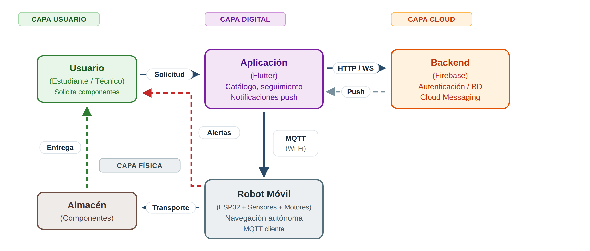
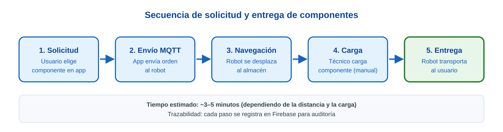

> Versión web del documento de Word «Capítulo I. Planteamiento del proyecto» (última modificación: 28/10/2026). Los índices con número de página se omitieron.

Facultad de Ingeniería

Escuela de Ingeniería en Telecomunicaciones

**Capítulo I. Planteamiento del proyecto**

Trabajo de Grado:

*“Robot móvil para búsqueda y transporte de componentes en el laboratorio*

*de la UCAB con aplicación de solicitudes y alertas”*

**Norma de citación y referenciación: IEEE**

**REALIZADO POR:**

Semprun Cascitelli, Iliana Vanessa

Ferrer Pinto, Andrea Valentina

**TUTOR:**

Ing. Cante Mata, Biagio Domenico

Caracas, octubre de 2026

---

# Capítulo I. Planteamiento del proyecto

En este capítulo se presentó el planteamiento del proyecto. Primero se describió el problema que dio origen al Trabajo de Grado, precisando su naturaleza, su impacto y su relevancia dentro del ámbito de la ingeniería de telecomunicaciones, y se formuló la interrogante que guió la investigación. Luego se establecieron los objetivos general y específicos, se expusieron las razones que justificaron la realización del trabajo y, por último, se delimitaron las limitaciones y los alcances del estudio.

## I.1 Planteamiento del problema

### I.1.1 Naturaleza del problema

En los laboratorios de la Escuela de Ingeniería en Telecomunicaciones de la Universidad Católica Andrés Bello (UCAB), la gestión y la entrega de componentes electrónicos se realizaba de forma manual y centralizada. El almacén de componentes se encontraba en un punto fijo de la planta baja, por lo que estudiantes y técnicos debían desplazarse cada vez que necesitaban resistencias, sensores, microcontroladores u otros materiales para sus prácticas y proyectos. El flujo de solicitud dependía, además, de que el usuario se presentara en persona en el almacén y de que el técnico encargado estuviera disponible para despachar el material.

A esta forma de operar se sumó la ausencia de un registro automatizado de las entregas. No existía un sistema que permitiera conocer qué componentes se habían retirado, quién los había solicitado y en qué momento, de modo que el control del inventario y la trazabilidad de los préstamos dependían de anotaciones manuales o de la memoria del personal del laboratorio.

El problema, por lo tanto, no fue solo de distancia o de comodidad, sino también de información: el laboratorio carecía de un mecanismo que vinculara la solicitud de un componente con su transporte y con su registro. Se trató de un problema de logística interna que podía abordarse con un sistema ciberfísico, en el que un robot móvil, una aplicación de solicitudes y un servidor intercambiaran información de forma continua a través de una red inalámbrica. En consecuencia, el problema central que se abordó fue la ausencia de un sistema automatizado de transporte interno y de trazabilidad de componentes en el laboratorio.

### I.1.2 Impacto del problema

La situación descrita tuvo efectos en tres planos. En el plano del tiempo, cada traslado al almacén interrumpía el trabajo en curso, obligaba a abandonar el puesto de trabajo y reducía las horas efectivas dedicadas a los proyectos académicos; estas interrupciones afectaban tanto a los estudiantes que solicitaban el material como a los técnicos que lo despachaban. En el plano del control, la falta de trazabilidad impedía saber con certeza cuántos componentes se consumían, cuáles se extraviaban y cuándo era necesario reponerlos, lo que dificultaba la planificación de las compras y la rendición de cuentas sobre el inventario. En el plano de la seguridad, cualquier solución que automatizara el traslado de material sin acompañamiento humano debía considerar, además, el riesgo de que la carga fuera manipulada durante el recorrido.

Este tipo de problema no fue exclusivo de la UCAB. Srinivas, Ramachandiran y Rajendran \[1\] revisaron el estado del arte de los robots autónomos de reparto y señalaron los campus universitarios y los entornos institucionales cerrados como escenarios preferentes para su despliegue, por tratarse de espacios delimitados, con tráfico predecible y rutas repetitivas. Esas condiciones coincidieron con las del laboratorio, lo que indicó que la automatización del transporte interno era técnicamente viable en este contexto.

### I.1.3 Relevancia en el ámbito de la ingeniería de telecomunicaciones

Aunque la parte visible de la solución fue un robot móvil, el eje que articuló el funcionamiento del sistema fue su arquitectura de comunicación inalámbrica. El robot, la aplicación y el servidor debían intercambiar órdenes de entrega, información de estado y alertas de seguridad en tiempo real, lo que situó el problema dentro de la Internet de las Cosas (IoT), un paradigma en el que objetos con capacidad de cómputo y conectividad se comunican mediante una pila de protocolos especializada \[2\]. La Figura 1 muestra la arquitectura general de la solución planteada, organizada en cuatro capas (usuario, digital, nube y física) y en los flujos de información que las vinculan.

El primer aspecto de telecomunicaciones fue la elección y el diseño de la mensajería. MQTT es un protocolo de publicación/suscripción, estandarizado por OASIS y concebido para entornos con recursos limitados, que ofrece tres niveles de calidad de servicio (QoS) para la entrega de mensajes \[3\]. Como ningún protocolo de mensajería satisface por igual los requisitos de todos los sistemas IoT \[4\], fue necesario justificar su uso y definir para cada flujo el nivel de QoS adecuado: no tiene la misma criticidad un mensaje periódico de estado que una orden de entrega o una alerta de manipulación. Esta decisión tuvo un costo medible, pues Lee et al. \[5\] comprobaron que un nivel de QoS más alto reduce la pérdida de mensajes, pero incrementa el retardo extremo a extremo. Determinar ese equilibrio en la red Wi-Fi real del laboratorio fue un problema propio de la ingeniería de telecomunicaciones.

**Figura** 1**.** Arquitectura general del sistema planteado.

*Fuente: elaboración propia.*

El segundo aspecto fue la localización del robot en interiores. La odometría, que estima el desplazamiento a partir del giro de las ruedas, acumula error con el tiempo y requiere correcciones periódicas \[6\]. Dado que en interiores el GPS no resulta viable, una alternativa de bajo costo para esas correcciones es el posicionamiento por radiofrecuencia basado en la intensidad de señal recibida (RSSI) de balizas Bluetooth de baja energía (BLE) \[7\], \[8\]. Esta técnica depende de la propagación de las señales en el entorno y de la calidad de su medición, aspectos que corresponden directamente al área de formación.

El tercer aspecto fue la entrega confiable y segura de la información al usuario. Las alertas debían llegar aunque la aplicación no estuviera abierta, para lo cual se contempló el uso de notificaciones push \[9\], y la comunicación con un servidor alojado en la nube debía protegerse frente a la escucha y la manipulación de los mensajes mediante cifrado, como el que ofrece TLS 1.3 \[10\].

Por último, la revisión de antecedentes mostró un vacío que reforzó la pertinencia del proyecto. Los trabajos sobre plataformas robóticas abiertas, como Robotont 3 \[11\], se concentraron en la plataforma mecánica y en la pila de navegación, mientras que la literatura consultada no abordó de forma conjunta el transporte autónomo y una arquitectura de comunicación con trazabilidad de inventario. En la propia Escuela, trabajos como los de Carvajal y Fernandes \[12\], sobre redes inalámbricas de transporte de datos para sistemas de tráfico inteligente, y Gómez y Mas \[13\], sobre un semáforo inalámbrico con tramas para órdenes, estado y alarmas, aplicaron las comunicaciones inalámbricas al control y la supervisión de dispositivos remotos. El presente Trabajo de Grado continuó esa línea, pero la llevó a un nodo móvil dentro del laboratorio y a un protocolo de mensajería propio de la IoT.

### I.1.4 Formulación del problema

A partir de lo expuesto, la investigación se orientó a responder la siguiente interrogante:

> *¿Cómo desarrollar un sistema de bajo costo, basado en un robot móvil autónomo y en una arquitectura de comunicación IoT, que automatizara el transporte de componentes en el laboratorio de la Escuela de Ingeniería en Telecomunicaciones de la UCAB y garantizara la trazabilidad de las entregas y la seguridad de la carga?*

De esta pregunta general se derivaron las siguientes interrogantes específicas:

- ¿Qué arquitectura de mensajería, y con qué niveles de QoS, permitiría intercambiar órdenes, estado y alertas entre el robot, la aplicación y el servidor con la fiabilidad y la latencia que exigía cada flujo?

- ¿Qué componentes de hardware ofrecerían el mejor equilibrio entre costo, consumo energético, disponibilidad y compatibilidad?

- ¿Qué combinación de seguimiento de línea, odometría, fusión de sensores inerciales y re-localización absoluta permitiría recorrer rutas conocidas acotando la deriva acumulada?

- ¿Cómo registrar cada solicitud y cada entrega para dar trazabilidad al inventario del laboratorio?

- ¿Con qué umbrales podría el acelerómetro detectar una manipulación no autorizada sin generar un número excesivo de falsas alarmas?

- ¿Qué desempeño alcanzaría el sistema integrado en una maqueta del laboratorio?

## I.2 Objetivos

A partir de la definición del problema se formularon un objetivo general y nueve objetivos específicos. Estos objetivos establecieron el horizonte del Trabajo de Grado, marcaron la secuencia de trabajo a seguir y delimitaron el alcance del estudio.

### I.2.1 Objetivo general

Desarrollar un prototipo funcional de robot móvil autónomo de bajo costo, integrado con una aplicación de solicitudes y un sistema de comunicación IoT, para el transporte y la trazabilidad de componentes electrónicos en el laboratorio de la Escuela de Ingeniería en Telecomunicaciones de la UCAB, incorporando un mecanismo de alertas de seguridad ante manipulación no autorizada.

### I.2.2 Objetivos específicos

1. Diseñar la arquitectura de comunicación inalámbrica del sistema (robot–aplicación–servidor) basada en el protocolo MQTT y servicios en la nube, definiendo los tópicos, la calidad de servicio (QoS) y los flujos de mensajes para órdenes, estado y alertas.

2. Realizar un estudio comparativo y seleccionar los componentes de hardware (microcontrolador, controlador de motores, sensores, batería) bajo criterios de costo, consumo energético, disponibilidad y compatibilidad.

3. Diseñar y construir la plataforma mecánica del robot, con chasis impreso en 3D y configuración de tracción diferencial, acorde con las dimensiones, cargas y rutas del entorno del laboratorio.

4. Desarrollar el firmware de control del robot, implementando el seguimiento de línea mediante control PID, la adquisición de sensores (línea, ultrasónicos e inercial) y la comunicación MQTT con el servidor.

5. Implementar un esquema de navegación progresivo que combine el seguimiento de línea con odometría y fusión de sensores inerciales, incorporando puntos de re-localización absoluta para acotar la deriva acumulada en rutas previamente mapeadas.

6. Desarrollar la aplicación móvil/web de solicitudes y el backend de trazabilidad, incluyendo catálogo de componentes, seguimiento del robot en tiempo real, historial de entregas y notificaciones.

7. Implementar el módulo de alertas de seguridad anti-manipulación basado en el acelerómetro, definiendo los umbrales de detección y evaluando la tasa de detección y la tasa de falsas alarmas.

8. Evaluar el desempeño integral del sistema mediante pruebas en una maqueta del laboratorio, midiendo la precisión de navegación, la latencia y fiabilidad de la comunicación, la autonomía energética y la eficacia de las alertas.

9. Documentar las limitaciones técnicas del sistema y proponer mejoras futuras orientadas a su escalabilidad y a su adaptación a otros entornos de aplicación.

Los objetivos específicos siguieron la secuencia propia de un proyecto de investigación y desarrollo: primero se diseñó y se seleccionó (objetivos 1, 2 y 3), luego se desarrolló e implementó cada subsistema (objetivos 4, 5, 6 y 7), después se evaluó el sistema integrado (objetivo 8) y, por último, se documentaron sus limitaciones y posibles mejoras (objetivo 9). En la Tabla 1 se relacionó cada objetivo específico con el producto verificable que se esperaba obtener y con la fase de la metodología en la que se atendió.

| **OE** | **Producto esperado**                                                                                                      | **Fase**                                |
|--------|----------------------------------------------------------------------------------------------------------------------------|-----------------------------------------|
| 1      | Documento de la arquitectura de comunicación: tópicos, niveles de QoS y flujos de mensajes para órdenes, estado y alertas. | II\. Diseño del sistema                 |
| 2      | Estudio comparativo de componentes, con su matriz comparativa y la selección justificada del hardware.                     | I. Revisión documental y requerimientos |
| 3      | Plataforma mecánica con chasis impreso en 3D y tracción diferencial, con sus planos.                                       | II y III. Diseño y construcción         |
| 4      | Firmware funcional (PID, adquisición de sensores y cliente MQTT), con pruebas unitarias.                                   | III\. Construcción y firmware           |
| 5      | Esquema de navegación progresiva validado por segmentos, con mediciones del error de posición.                             | IV\. Navegación progresiva              |
| 6      | Aplicación de solicitudes integrada con el backend de trazabilidad y las notificaciones.                                   | V. Aplicación y backend                 |
| 7      | Módulo de alertas con umbrales definidos y sus tasas de detección y de falsas alarmas.                                     | VI\. Integración y alertas              |
| 8      | Informe de resultados de las pruebas en maqueta: navegación, latencia y fiabilidad, autonomía y alertas.                   | VII\. Pruebas y validación              |
| 9      | Documento de limitaciones técnicas y propuesta de mejoras futuras.                                                         | VII\. Pruebas y validación              |

**Tabla** 1**.** Relación entre los objetivos específicos, los productos esperados y las fases de la metodología.

*Fuente: elaboración propia a partir de la propuesta del Trabajo de Grado, el reporte de productos y la metodología.*

## I.3 Justificación

La realización de este Trabajo de Grado se justificó, en primer lugar, por su aporte práctico al laboratorio. La automatización del transporte interno buscó reducir los desplazamientos y las interrupciones de estudiantes y técnicos, mientras que el registro automático de cada entrega permitió conocer qué se retiró, quién lo solicitó y cuándo, información que antes no existía y que facilita el control del inventario.

En segundo lugar, el proyecto tuvo un valor tecnológico. Se planteó un prototipo de bajo costo, construido con componentes comerciales, chasis impreso en 3D y un microcontrolador ESP32 con conectividad Wi-Fi y Bluetooth integrada \[14\]. Experiencias como la de Robotont 3 mostraron que este tipo de diseño facilita la reparación de piezas y la réplica de la plataforma en otras instituciones \[11\]. Por ello, la arquitectura de comunicaciones y de logística interna desarrollada pudo adaptarse a otros entornos, como almacenes educativos, talleres u oficinas.

En tercer lugar, el trabajo aportó al área de las telecomunicaciones datos experimentales propios. La evaluación del sistema contempló medir la latencia y la fiabilidad de los mensajes MQTT según su nivel de QoS en la red real del laboratorio, lo que permitió contrastar con un caso concreto el equilibrio entre fiabilidad y retardo descrito en la literatura \[5\]. Del mismo modo, el uso de balizas BLE para corregir la posición del robot permitió valorar la utilidad del RSSI como apoyo a la navegación en interiores \[8\].

En cuarto lugar, el enfoque de navegación progresiva tuvo una justificación metodológica. Comenzar con el seguimiento de línea, un método robusto y económico, y avanzar por etapas hacia la navegación con odometría y fusión de sensores, técnica de referencia para robots móviles con recursos de cómputo limitados \[15\], redujo el riesgo técnico y permitió validar cada etapa de forma independiente, manteniendo siempre la línea como recurso de recuperación.

Finalmente, el proyecto tuvo un valor formativo, ya que integró en un mismo sistema conocimientos de comunicaciones inalámbricas, protocolos de red, electrónica, control y desarrollo de software, que son las competencias que se esperan de un ingeniero en telecomunicaciones.

## I.4 Limitaciones y alcances

### I.4.1 Limitaciones

El Trabajo de Grado no abarcó los siguientes aspectos:

- La operación simultánea de una flota de múltiples robots ni los mecanismos de coordinación multi-robot.

- La navegación totalmente autónoma en entornos desconocidos o dinámicos no mapeados (SLAM completo).

- El despliegue ni las certificaciones para entornos hospitalarios o clínicos, que se mencionaron únicamente como aplicaciones futuras.

- La manipulación robótica automatizada (brazos) para la carga y descarga de componentes; la carga se realizó de forma manual o mediante un compartimiento simple.

- La integración con sistemas de inventario institucionales preexistentes.

- Garantías de precisión de posicionamiento independientes de la infraestructura de balizas BLE o marcadores QR instalada en el entorno de prueba.

### I.4.2 Alcances

El Trabajo de Grado comprendió los siguientes elementos:

- Un (1) prototipo funcional de robot móvil de bajo costo, validado en una maqueta o entorno controlado del laboratorio de la UCAB.

- El seguimiento de línea con control PID y un esquema de navegación progresiva en rutas previamente mapeadas, en el que la línea se mantuvo como recurso de recuperación.

- La aplicación móvil/web de solicitudes, el backend de trazabilidad y las notificaciones a los usuarios.

- El módulo de alertas de seguridad anti-manipulación basado en el acelerómetro.

- La arquitectura de comunicación IoT mediante MQTT sobre una red Wi-Fi local, junto con la evaluación de su fiabilidad y su latencia.

El ciclo operativo completo que cubrió el sistema se ilustra en la Figura 2. El paso 4 corresponde a la carga manual del componente por parte del técnico, ya que la manipulación del material no se automatizó, lo que constituyó una de las limitaciones declaradas en la sección anterior. El desarrollo se planificó para una duración de 32 semanas, dentro del rango reglamentario de la Escuela.

**Figura** 2**.** Flujo operativo de solicitud y entrega de componentes.

*Fuente: elaboración propia.*

# Bibliografía

\[1\] S. Srinivas, S. Ramachandiran y S. Rajendran, “Autonomous robot-driven deliveries: A review of recent developments and future directions,” *Transportation Research Part E: Logistics and Transportation Review*, vol. 165, art. 102834, 2022, doi: 10.1016/j.tre.2022.102834.

\[2\] A. Al-Fuqaha, M. Guizani, M. Mohammadi, M. Aledhari y M. Ayyash, “Internet of Things: A survey on enabling technologies, protocols, and applications,” *IEEE Commun. Surveys Tuts.*, vol. 17, n.º 4, pp. 2347–2376, 2015, doi: 10.1109/COMST.2015.2444095.

\[3\] A. Banks, E. Briggs, K. Borgendale y R. Gupta, Eds., *MQTT Version 5.0*, OASIS Standard, 7 mar. 2019. Accedido: 28 oct. 2026. \[En línea\]. Disponible: https://docs.oasis-open.org/mqtt/mqtt/v5.0/os/mqtt-v5.0-os.html

\[4\] N. Naik, “Choice of effective messaging protocols for IoT systems: MQTT, CoAP, AMQP and HTTP,” en *Proc. IEEE Int. Syst. Eng. Symp. (ISSE)*, Viena, Austria, 2017, pp. 1–7, doi: 10.1109/SysEng.2017.8088251.

\[5\] S. Lee, H. Kim, D.-K. Hong y H. Ju, “Correlation analysis of MQTT loss and delay according to QoS level,” en *Proc. Int. Conf. Inf. Netw. (ICOIN)*, 2013, pp. 714–717, doi: 10.1109/ICOIN.2013.6496715.

\[6\] R. Siegwart, I. R. Nourbakhsh y D. Scaramuzza, *Introduction to Autonomous Mobile Robots*, 2.ª ed. Cambridge, MA, EE. UU.: MIT Press, 2011.

\[7\] R. Ramirez, C.-Y. Huang, C.-A. Liao, P.-T. Lin, H.-W. Lin y S.-H. Liang, “A practice of BLE RSSI measurement for indoor positioning,” *Sensors*, vol. 21, n.º 15, art. 5181, 2021, doi: 10.3390/s21155181.

\[8\] S. Sadowski y P. Spachos, “RSSI-based indoor localization with the Internet of Things,” *IEEE Access*, vol. 6, pp. 30149–30161, 2018, doi: 10.1109/ACCESS.2018.2843325.

\[9\] Google, “Firebase Cloud Messaging,” *Firebase Documentation*. Accedido: 28 oct. 2026. \[En línea\]. Disponible: https://firebase.google.com/docs/cloud-messaging

\[10\] E. Rescorla, “The Transport Layer Security (TLS) protocol version 1.3,” IETF, RFC 8446, ago. 2018, doi: 10.17487/RFC8446.

\[11\] E. Mõtshärg, V. Vunder, R. Raudmäe, M. Muro, I. Drikkit, L. Tšigrinski, R. Köidam, A. Aabloo y K. Kruusamäe, “Robotont 3 — an accessible 3D-printable ROS-supported open-source mobile robot for education and research,” *Frontiers in Robotics and AI*, vol. 11, art. 1406645, 2024, doi: 10.3389/frobt.2024.1406645.

\[12\] M. L. Carvajal Carvajal y A. E. Fernandes Da Silva, “Diseño eficiente de redes de transporte de datos para los sistemas y servicios de tráfico inteligente ofrecidos por el Grupo InTech Solutions,” Trabajo Especial de Grado, Esc. de Ing. de Telecomunicaciones, Universidad Católica Andrés Bello, Caracas, Venezuela, 2012.

\[13\] M. Gómez y C. Mas, “Diseño de un semáforo inalámbrico, soportado por un subsistema de la plataforma de control de tráfico PISACOTA,” Trabajo Especial de Grado, Esc. de Ing. de Telecomunicaciones, Universidad Católica Andrés Bello, Caracas, Venezuela, 2007.

\[14\] Espressif Systems, *ESP32 Series Datasheet*. Accedido: 28 oct. 2026. \[En línea\]. Disponible: https://www.espressif.com/sites/default/files/documentation/esp32_datasheet_en.pdf

\[15\] V. Ušinskis, M. Nowicki, A. Dzedzickis y V. Bučinskas, “Sensor-fusion based navigation for autonomous mobile robot,” *Sensors*, vol. 25, n.º 4, art. 1248, 2025, doi: 10.3390/s25041248.
