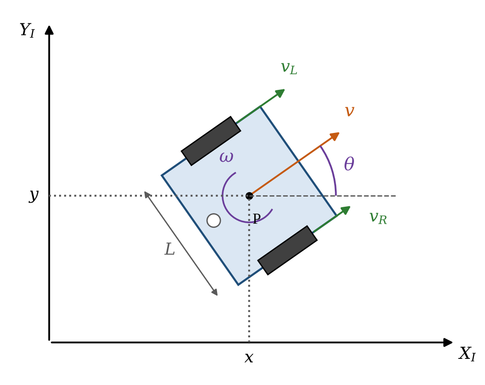
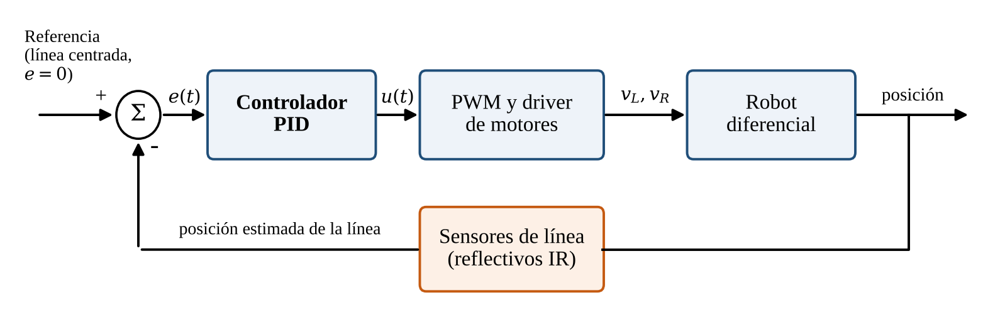
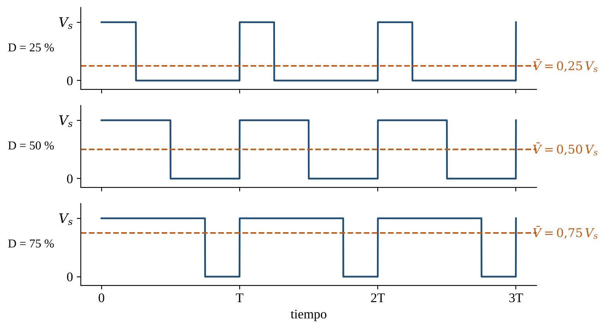
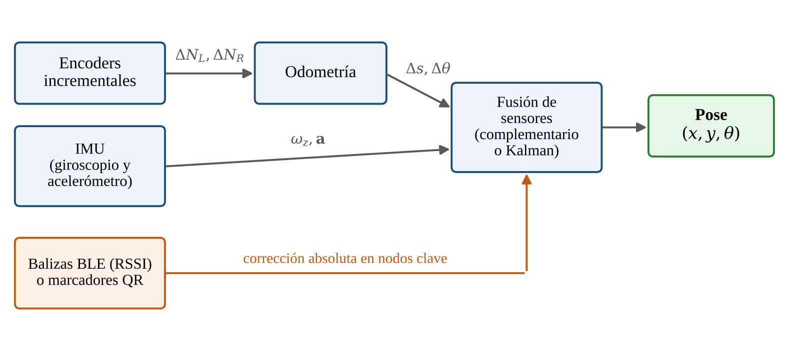
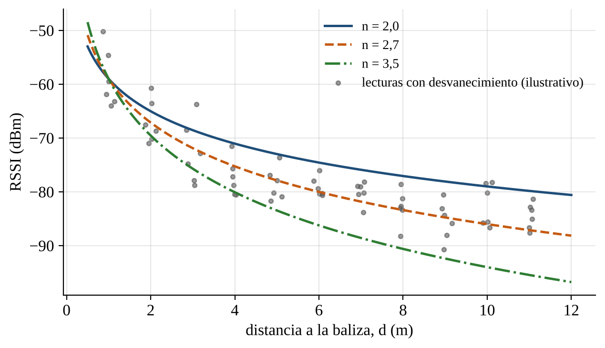
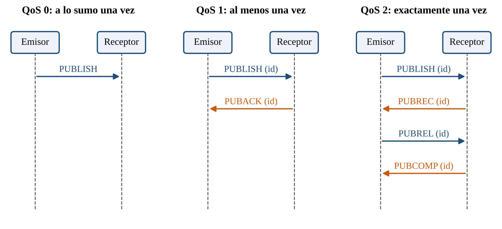
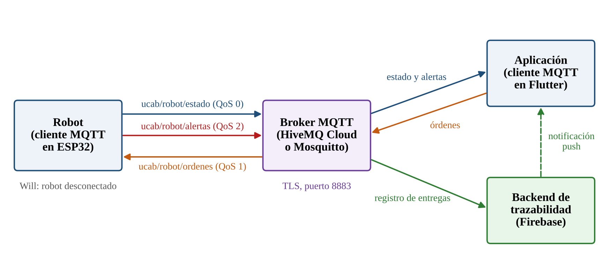

> Versión web del documento de Word «Capítulo II. Marco teórico» (última modificación: 13/11/2026). Los índices con número de página se omitieron.

UNIVERSIDAD CATÓLICA ANDRÉS BELLO

Facultad de Ingeniería

Escuela de Ingeniería en Telecomunicaciones

**Capítulo II. Marco teórico**

Trabajo de Grado:

*“Robot móvil para búsqueda y transporte de componentes en el laboratorio*

*de la UCAB con aplicación de solicitudes y alertas”*

**REALIZADO POR:**

Semprun Cascitelli, Iliana Vanessa

Ferrer Pinto, Andrea Valentina

**TUTOR:**

Ing. Cante Mata, Biagio Domenico

Caracas, noviembre de 2026

---

# Capítulo II. Marco teórico

**En este capítulo se presentó el marco teórico que dio soporte al Trabajo de Grado. Primero se expusieron los antecedentes de la investigación, organizados en trabajos de grado de la propia Escuela, tesis sobre robótica móvil y sistemas multi-robot, revisiones sobre robots de reparto y plataformas abiertas, y evaluaciones de protocolos de mensajería para la Internet de las Cosas (IoT). Luego se desarrollaron las bases teóricas, siguiendo el mismo recorrido con el que se construyó el sistema: desde la plataforma física del robot (locomoción, sensores, control y localización), pasando por el sistema embebido y las redes inalámbricas, hasta la mensajería MQTT, los servicios en la nube, la de la investigación. Para comprobar que cada contenido teórico sustentara una parte concreta del proyecto, la Tabla 1 relacionó cada sección del capítulo con los objetivos específicos (OE) formulados en el Capítulo I.**

| **Sección**                          | **Contenido que aporta al proyecto**                                                                                           | **OE**  |
|--------------------------------------|--------------------------------------------------------------------------------------------------------------------------------|---------|
| II.1 Antecedentes                    | Estado del arte en comunicaciones inalámbricas, robots móviles y de reparto, y protocolos IoT; delimita el aporte del trabajo. | 1, 9    |
| II.2.1 Robótica móvil                | Tracción diferencial y modelo cinemático para dimensionar el chasis y estimar la trayectoria.                                  | 3, 5    |
| II.2.2 Sensores                      | Principio de funcionamiento de los sensores de línea, ultrasónicos, IMU y encoders.                                            | 2, 4    |
| II.2.3 Control de movimiento         | Seguimiento de línea, control PID y accionamiento de motores por PWM.                                                          | 4       |
| II.2.4 Localización                  | Odometría, fusión de sensores y re-localización absoluta para acotar la deriva.                                                | 5       |
| II.2.5 ESP32                         | Procesamiento, periféricos y conectividad del microcontrolador.                                                                | 2, 4    |
| II.2.6 Redes inalámbricas            | Wi-Fi como transporte de la mensajería; BLE y RSSI para la re-localización.                                                    | 1, 5    |
| II.2.7 Protocolo MQTT                | Tópicos, niveles de QoS y flujos de mensajes para órdenes, estado y alertas.                                                   | 1, 4, 8 |
| II.2.8 y II.2.9 Backend y aplicación | Base de datos, autenticación, notificaciones push y desarrollo multiplataforma.                                                | 6       |
| II.2.10 Detección de manipulación    | Umbrales del acelerómetro y métricas de detección y de falsas alarmas.                                                         | 7       |
| II.2.11 Impresión 3D                 | Fabricación aditiva del chasis en PLA.                                                                                         | 3       |
| II.2.12 Métricas de desempeño        | Indicadores para evaluar el prototipo en la maqueta.                                                                           | 8       |
| II.3 Bases normativas                | Marco legal y estándares de las tecnologías de comunicación y re-localización.                                                 | 1, 5    |
| II.4 Términos básicos                | Definición de los conceptos técnicos del trabajo.                                                                              | Todos   |

**Tabla** 1*.* Correspondencia entre las secciones del marco teórico y los objetivos específicos.

*Fuente: elaboración propia a partir de los objetivos del Capítulo I.*

## II.1 Antecedentes de la investigación

Los antecedentes reunieron trabajos previos que abordaron problemas cercanos al de este Trabajo de Grado, ya sea por la tecnología empleada (comunicaciones inalámbricas, robots móviles, mensajería IoT) o por el tipo de aplicación (transporte autónomo en entornos acotados). Para cada uno se indicó el problema que trató, el método que siguió, los resultados que obtuvo y el aporte que hizo a este proyecto.

### II.1.1 Trabajos de grado de la Escuela de Ingeniería en Telecomunicaciones de la UCAB

Carvajal y Fernandes \[1\] diseñaron redes de transporte de datos para los sistemas de tráfico inteligente del Grupo InTech Solutions, cuyos productos (gestión de semáforos, información de tráfico y circuito cerrado de televisión) presentaban requisitos distintos de topología y de ancho de banda. El trabajo se desarrolló en cinco fases, desde la revisión bibliográfica hasta el diseño detallado, y validó los diseños mediante cálculos de pérdidas en espacio libre, potencia de recepción y margen de desvanecimiento, junto con simulaciones en Radio Mobile. Las autoras seleccionaron enlaces Wi-Fi en la banda de 5,8 GHz con topologías en estrella y punto a punto, y reportaron que el modo AP/Bridge mejoró el rendimiento en un 30 % frente al modo WDS. Para el presente proyecto, este antecedente aportó un método para seleccionar la tecnología inalámbrica según los requisitos de cada flujo de datos y para fundamentar el cálculo de enlaces en la propagación de la señal.

Gómez y Mas \[2\] diseñaron un semáforo inalámbrico para la plataforma de control de tráfico PISACOTA del Municipio Chacao, donde las fallas de comunicación entre la central y los semáforos dificultaban los cambios de secuencia y la atención de emergencias. Las autoras compararon tecnologías inalámbricas (infrarrojo, Wi-Fi, WiMAX y telefonía celular), seleccionaron la red celular por su cobertura y por no requerir línea de vista, y definieron tramas propias para enviar órdenes, reportar el estado de cada unidad y transmitir alarmas y solicitudes de paso peatonal. El prototipo controló una intersección de cuatro semáforos vehiculares y cuatro peatonales. Este trabajo mostró, en la misma Escuela, la separación entre mensajes de órdenes, de estado y de alarma que el presente Trabajo de Grado retomó en la estructura de tópicos MQTT.

### II.1.2 Trabajos sobre robótica móvil y sistemas multi-robot

López Hernández \[3\] programó un robot móvil de bajo costo, basado en Raspberry Pi y Arduino, capaz de recorrer y vigilar una vivienda, construir un mapa bidimensional, evitar obstáculos con sensores ultrasónicos HC-SR04 y transmitir video en tiempo real a una interfaz web. El desarrollo siguió una metodología en cascada y almacenó los movimientos del robot en una matriz de 512 × 512 celdas. Entre sus limitaciones, el autor reportó pérdida de cuadros de video al alejarse del enrutador y dificultades en entornos con muchos obstáculos. Este antecedente aportó una arquitectura completa de hardware y software para un robot de bajo costo y evidenció que la cobertura de la red inalámbrica condiciona el desempeño de un robot conectado.

Gil Pérez \[4\] propuso AMEB, una arquitectura distribuida para sistemas multi-robot con comportamiento emergente, organizada en un nivel individual, un nivel colectivo y un nivel de gestión del conocimiento. La arquitectura se implementó en robots de propósito general con Arduino y módulos XBee, compartió información entre robots mediante mensajes MQTT y feromonas artificiales, y se evaluó en tareas de transporte de objetos y de búsqueda de rutas, con altos niveles de emergencia y de auto-organización en simulación. Aunque la operación multi-robot quedó fuera del alcance de este Trabajo de Grado, el antecedente mostró el uso de MQTT como medio de coordinación entre robots y de sensores infrarrojos, ultrasónicos e inerciales en tareas de transporte.

Alonso Hernández \[5\] estudió la convergencia de las arquitecturas de software, la robótica colaborativa y el aprendizaje automático en la Industria 5.0, mediante casos de estudio en líneas piloto. Entre los elementos que analizó se encontraron las plataformas interoperables basadas en componentes, la mensajería MQTT para integrar equipos industriales y un metamarco de seguridad y privacidad. Su aporte a este proyecto fue mostrar que la interoperabilidad, la seguridad de las comunicaciones y la centralidad del usuario son requisitos de diseño, y no añadidos posteriores, en sistemas donde personas y robots comparten el espacio de trabajo.

### II.1.3 Robots autónomos de reparto y plataformas robóticas abiertas

Srinivas, Ramachandiran y Rajendran \[6\] revisaron el estado del arte de los robots autónomos de reparto y sistematizaron sus componentes tecnológicos, sus modelos de operación y los retos abiertos del área, entre ellos la navegación fiable, la interacción con los usuarios y la gestión de la última etapa de la entrega. Los autores identificaron los campus universitarios y los entornos institucionales cerrados como escenarios preferentes de despliegue, por tratarse de espacios delimitados, con tráfico predecible y rutas repetitivas, condiciones que coinciden con las del laboratorio de la Escuela.

Mõtshärg et al. \[7\] presentaron Robotont 3, una plataforma robótica móvil de código abierto, imprimible en 3D y compatible con ROS, concebida para la docencia y la investigación. El trabajo demostró que es posible construir robots móviles funcionales con componentes comerciales y fabricación aditiva, y sostuvo que la facilidad de reparación y la replicabilidad del diseño son tan relevantes como su desempeño. Este antecedente respaldó la decisión de fabricar el chasis en PLA y de documentar el prototipo para que pueda replicarse en otras instituciones.

### II.1.4 Evaluaciones de protocolos de mensajería para IoT

Naik \[8\] comparó los protocolos MQTT, CoAP, AMQP y HTTP según el tamaño y la sobrecarga de los mensajes, el consumo de energía, el ancho de banda, la latencia, la fiabilidad, la interoperabilidad y la seguridad, y concluyó que ningún protocolo satisface por igual los requisitos de todos los sistemas IoT, de modo que la elección depende de cada aplicación. Lee et al. \[9\] analizaron experimentalmente la transmisión de mensajes MQTT entre un publicador, un broker y un suscriptor reales, en redes cableadas e inalámbricas, y comprobaron que un nivel de calidad de servicio (QoS) más alto reduce la pérdida de mensajes, pero incrementa el retardo extremo a extremo. Mishra y Kertesz \[10\] revisaron el uso de MQTT en sistemas M2M e IoT, describieron la evolución del protocolo hasta la versión 5.0 y lo situaron como uno de los protocolos de mensajería más adoptados en dispositivos con recursos limitados.

**Estos tres trabajos dieron fundamento a dos decisiones del proyecto: justificar el uso de MQTT frente a otros protocolos según las necesidades concretas del sistema, y asignar a cada flujo de mensajes un nivel de QoS distinto, midiendo después su efecto sobre la latencia en la red real del laboratorio. La Tabla 2 resumió los antecedentes revisados y su aporte al Trabajo de Grado.**

| **Antecedente**                                       | **Tema y resultado principal**                                                                                                     | **Aporte al Trabajo de Grado**                                                           |
|-------------------------------------------------------|------------------------------------------------------------------------------------------------------------------------------------|------------------------------------------------------------------------------------------|
| Carvajal y Fernandes \[1\], UCAB, 2012                | Redes inalámbricas de transporte de datos para tráfico inteligente; Wi-Fi en 5,8 GHz validado con cálculo de enlaces y simulación. | Selección de la tecnología inalámbrica según los requisitos de cada flujo de datos.      |
| Gómez y Mas \[2\], UCAB, 2007                         | Semáforo inalámbrico con tramas para órdenes, estado y alarmas sobre red celular.                                                  | Separación de mensajes de órdenes, estado y alarma, retomada en los tópicos MQTT.        |
| López Hernández \[3\], UAL, 2018                      | Robot de bajo costo con mapas, evasión de obstáculos y video en tiempo real.                                                       | Arquitectura de hardware y software de un robot conectado; efecto de la cobertura Wi-Fi. |
| Gil Pérez \[4\], ULA, 2019                            | Arquitectura multi-robot AMEB con mensajes MQTT en tareas de transporte.                                                           | Uso de MQTT para coordinar robots y de sensores infrarrojos, ultrasónicos e inerciales.  |
| Alonso Hernández \[5\], UPM, 2025                     | Plataformas interoperables, robótica colaborativa y seguridad en la Industria 5.0.                                                 | Interoperabilidad y seguridad como requisitos de diseño.                                 |
| Srinivas et al. \[6\], 2022                           | Revisión del estado del arte de los robots autónomos de reparto.                                                                   | Viabilidad del transporte autónomo en campus y entornos cerrados.                        |
| Mõtshärg et al. \[7\], 2024                           | Plataforma robótica abierta e imprimible en 3D para docencia.                                                                      | Chasis en PLA, bajo costo y replicabilidad.                                              |
| Naik \[8\]; Lee et al. \[9\]; Mishra y Kertesz \[10\] | Comparación de protocolos IoT; relación entre QoS, pérdida y retardo en MQTT.                                                      | Justificación de MQTT y del QoS diferenciado por flujo.                                  |

**Tabla** 2*.* Síntesis de los antecedentes y de su aporte al Trabajo de Grado.

*Fuente: elaboración propia a partir de los trabajos citados y del reporte de investigación de tesis.*

En conjunto, los antecedentes mostraron que el transporte autónomo en entornos cerrados, las plataformas robóticas de bajo costo y la mensajería IoT se habían estudiado por separado. Ninguno de los trabajos revisados integró en un mismo sistema el transporte de componentes, una arquitectura de mensajería con QoS diferenciado por flujo, la re-localización por radiofrecuencia y una aplicación con trazabilidad de inventario, que es el aporte que buscó este Trabajo de Grado.

## II.2 Bases teóricas

Las bases teóricas reunieron los conceptos, modelos y tecnologías en los que se apoyó el diseño del sistema. Se presentaron en el mismo orden en que se construyó el prototipo, desde la plataforma física hasta el usuario.

### II.2.1 Robótica móvil

La robótica móvil estudia los mecanismos que permiten a un robot desplazarse en un entorno real para cumplir una tarea. Siegwart, Nourbakhsh y Scaramuzza \[11\] organizan este problema en cuatro competencias: la locomoción, que define cómo se mueve el robot; la percepción, que le permite obtener información del entorno con sus sensores; la localización, que le permite estimar su posición; y la planificación del movimiento, que le permite decidir cómo llegar a su destino. El prototipo de este trabajo abordó las cuatro competencias en un entorno conocido y acotado.

#### II.2.1.1 Locomoción con ruedas y configuración de tracción diferencial

La locomoción con ruedas es la más empleada en robots móviles que operan sobre superficies planas, porque es mecánicamente sencilla y energéticamente eficiente \[11\]. Entre sus configuraciones, la tracción diferencial utiliza dos ruedas motrices independientes situadas sobre un mismo eje y una o dos ruedas locas que solo sirven de apoyo. El robot avanza en línea recta cuando ambas ruedas giran a la misma velocidad, gira cuando sus velocidades difieren y rota sobre su propio eje cuando giran a la misma velocidad en sentidos opuestos \[11\]. Esta capacidad de girar en el sitio, junto con la sencillez de su control, la hace adecuada para espacios interiores reducidos como los pasillos y las mesas de un laboratorio.

Como contrapartida, la tracción diferencial es una configuración no holonómica: el robot no puede desplazarse lateralmente, sino solo en la dirección hacia la que apunta, por lo que cualquier cambio de dirección exige primero un giro \[11\]. Esta restricción se tuvo en cuenta al definir las rutas y los puntos de parada del robot.

#### II.2.1.2 Modelo cinemático del robot diferencial

El modelo cinemático relaciona las velocidades de las ruedas con el movimiento del robot en el plano. Se define la pose del robot como el vector (x, y, θ), donde x e y son las coordenadas del punto P, situado en el centro del eje de las ruedas, respecto a un sistema de referencia global, y θ es el ángulo de orientación del robot respecto al eje XI \[11\]. La Figura 1 muestra estas variables.

**Figura** 1*.* Modelo cinemático del robot de tracción diferencial.

*Fuente: elaboración propia a partir de \[11\].*

Si r es el radio de las ruedas, L la distancia entre ellas y ωR y ωL sus velocidades angulares, las velocidades lineales de cada rueda son vR = r·ωR y vL = r·ωL. La velocidad lineal v del punto P y la velocidad angular ω del robot se obtienen como \[11\]:

v = (vR + vL) / 2, ω = (vR - vL) / L (1)

A partir de ellas, la variación de la pose en el sistema global queda descrita por:

dx/dt = v·cos θ, dy/dt = v·sin θ, dθ/dt = ω (2)

Las ecuaciones (1) y (2) permiten realizar dos operaciones que el proyecto necesitó. En sentido directo, permiten estimar la trayectoria del robot a partir de la velocidad de sus ruedas, que es la base de la odometría (sección II.2.4.1). En sentido inverso, permiten calcular qué velocidad debe imponerse a cada rueda para obtener un avance v y un giro ω deseados, que es lo que hace el controlador al corregir la trayectoria. Además, el modelo mostró que la distancia L entre ruedas influye directamente en la precisión del giro, por lo que su valor se tuvo en cuenta en el diseño del chasis.

### II.2.2 Sensores del robot

Los sensores permiten al robot medir su propio estado y el de su entorno. Siegwart et al. \[11\] los clasifican en propioceptivos, que miden variables internas del robot, como la velocidad de los motores o la aceleración, y exteroceptivos, que miden el entorno, como la distancia a un obstáculo o la presencia de una línea en el suelo. El prototipo combinó ambos tipos: sensores ópticos de línea y ultrasónicos, que son exteroceptivos, y encoders y una unidad de medición inercial, que son propioceptivos.

#### II.2.2.1 Sensores ópticos reflectivos para el seguimiento de línea

Un sensor óptico reflectivo integra en un mismo encapsulado un emisor infrarrojo y un fotodetector orientados hacia la superficie. La luz emitida se refleja con mayor intensidad sobre una superficie clara que sobre una oscura, de modo que la corriente del fotodetector permite distinguir entre el suelo y una cinta de contraste. El TCRT5000 de Vishay, por ejemplo, emplea un emisor de 950 nm y un fototransistor con filtro de luz diurna, y tiene un rango de operación de 0,2 mm a 15 mm \[12\]. Al disponer varios de estos sensores en fila, perpendiculares a la dirección de avance, el robot puede estimar no solo si está sobre la línea, sino también cuánto se ha desplazado respecto a su centro, que es la magnitud que necesita el controlador.

#### II.2.2.2 Medición de distancia por ultrasonido

Los sensores ultrasónicos miden la distancia a un objeto a partir del tiempo de vuelo de un pulso acústico: el transductor emite un tren de ondas, típicamente de unos 40 kHz, y mide el tiempo t que tarda el eco en regresar tras rebotar en el obstáculo \[11\]. Como el sonido recorre dos veces la distancia, esta se calcula como:

d = c·t / 2 (3)

donde c es la velocidad del sonido en el aire, aproximadamente 343 m/s a 20 °C, que varía con la temperatura. Estos sensores son económicos y funcionan con cualquier iluminación, pero su haz es cónico, lo que limita su resolución angular, y pueden producir lecturas erróneas ante superficies inclinadas o materiales que absorben el sonido \[11\]. Módulos comerciales como el HC-SR04 se han empleado en robots de bajo costo para evitar colisiones \[3\], y esa fue su función en el prototipo.

#### II.2.2.3 Unidad de medición inercial: acelerómetro y giroscopio

Una unidad de medición inercial (IMU) combina un acelerómetro, que mide la aceleración lineal en cada eje, incluida la debida a la gravedad, y un giroscopio, que mide la velocidad angular alrededor de cada eje. El MPU-6050 de TDK InvenSense integra en un solo circuito un acelerómetro y un giroscopio de tres ejes con conversores analógico-digitales de 16 bits, rangos programables de ±2, ±4, ±8 y ±16 g para la aceleración y de ±250, ±500, ±1000 y ±2000 °/s para la velocidad angular, e interfaz digital I²C \[13\].

En este proyecto la IMU cumplió dos funciones. El giroscopio aportó la velocidad de giro del robot para mejorar la estimación de su orientación (sección II.2.4.2), y el acelerómetro permitió detectar movimientos anómalos del robot cuando no estaba en misión (sección II.2.10). Ambos sensores tienen limitaciones conocidas: el giroscopio presenta un sesgo que, al integrarse en el tiempo, produce una deriva creciente en el ángulo estimado, y el acelerómetro es sensible a las vibraciones \[11\], \[14\]. Por esa razón sus lecturas no se usaron de forma aislada, sino combinadas con otras fuentes.

> **Nota de auditoría (19/11/2026, solo en esta versión web):** la MPU-6050 forma parte del hardware elegido, pero su lectura está **[PENDIENTE DE INTEGRACIÓN EN FIRMWARE]** (solo existe el gancho para conectarla) y no hay mediciones del giroscopio ni del acelerómetro. Las funciones descritas son el diseño previsto, no un resultado. El giroscopio también servirá para mantener el rumbo relativo (*heading hold*) en los tramos sin cinta entre puntos de control confirmados por balizas BLE; sin magnetómetro, no hay rumbo absoluto. **[PENDIENTE DE MEDICIÓN FÍSICA]**

#### II.2.2.4 Encoders incrementales

Un encoder incremental genera un número fijo de pulsos por cada vuelta del eje al que está acoplado. Contando los pulsos en un intervalo de tiempo se obtienen el ángulo girado y la velocidad de la rueda \[11\]. Los encoders de cuadratura tienen dos canales desfasados 90°, lo que permite conocer también el sentido de giro y multiplicar por cuatro la resolución al contar todos los flancos de ambas señales. Si N es el número de pulsos por vuelta y r el radio de la rueda, la distancia recorrida por cada pulso es:

Δspulso = 2π·r / N (4)

Esta resolución define la menor distancia que el robot puede medir con sus ruedas y es el dato de partida de la odometría.

En el prototipo se emplearon motorreductores JGA25-371 con un encoder magnético de efecto Hall que entrega 11 pulsos por vuelta del motor en cada canal, acoplados a una caja reductora de 21,3:1. Contando los cuatro flancos de ambos canales, cada vuelta de la rueda produce N = 11 · 21,3 · 4 ≈ 937 cuentas; con ruedas de 65 mm de diámetro (r = 32,5 mm), la ecuación (4) da una resolución cercana a 0,22 mm por cuenta. Los encoders se alimentaron con 3,3 V para que sus señales fueran compatibles con las entradas del ESP32.

### II.2.3 Control de movimiento

#### II.2.3.1 Seguimiento de línea

El seguimiento de línea es un método de guiado en el que el robot recorre una trayectoria marcada en el suelo con una cinta de contraste. Es robusto y económico, porque no requiere conocer la posición absoluta del robot, sino solo su desviación respecto a la línea. Con una fila de n sensores reflectivos, la posición de la línea puede estimarse como un promedio ponderado de las lecturas:

xl = Σ (wi·si) / Σ si (5)

donde si es la lectura normalizada del sensor i y wi su posición respecto al centro del robot. La diferencia entre xl y el centro del robot es el error y que el controlador intenta llevar a cero. En el esquema de navegación progresiva del proyecto, la línea cumplió además una segunda función: sirvió como referencia para registrar datos de la ruta y como recurso de recuperación cuando el robot perdía su estimación de posición.

#### II.2.3.2 Control proporcional-integral-derivativo (PID)

El control por realimentación compara de forma continua la salida medida de un sistema con su valor deseado y actúa sobre el sistema para reducir la diferencia. El controlador proporcional-integral-derivativo (PID) es la técnica de realimentación más extendida en la ingeniería \[15\]. Su acción de control u(t) se calcula a partir del error e(t) como:

u(t) = Kp·e(t) + Ki·∫ e(τ) dτ + Kd·de(t)/dt (6)

El término proporcional reacciona al error presente; el integral acumula el error pasado y elimina el error en estado estacionario; y el derivativo anticipa la tendencia del error y amortigua las oscilaciones \[15\]. En un microcontrolador, la ecuación se implementa en forma discreta, con un período de muestreo Ts:

uk = Kp·ek + Ki·Ts·Σ ej + Kd·(ek - ek-1) / Ts (7)

En el seguimiento de línea, la salida u del controlador se suma a la velocidad base de una rueda y se resta a la de la otra, de modo que el robot gira hacia la línea en proporción a su desviación. La Figura 2 muestra el lazo de control resultante. El ajuste de las ganancias Kp, Ki y Kd determina el compromiso entre rapidez de respuesta y estabilidad: ganancias muy altas producen oscilaciones alrededor de la línea y ganancias muy bajas hacen que el robot la pierda en las curvas \[15\].

**Figura** 2*.* Lazo de control PID aplicado al seguimiento de línea.

*Fuente: elaboración propia a partir de \[15\].*

#### II.2.3.3 Modulación por ancho de pulso (PWM) y accionamiento de motores DC

La velocidad de un motor de corriente continua (DC) depende de la tensión media aplicada a su armadura \[16\]. Un microcontrolador no entrega tensiones analógicas de potencia, pero puede generar una señal de modulación por ancho de pulso (PWM): una onda cuadrada de frecuencia fija cuyo ciclo de trabajo D, definido como la fracción del período T en que la señal está en alto, se ajusta por software. Cuando esa señal gobierna un interruptor de potencia, la tensión media que recibe el motor es:

Vmedia = D·Vs (8)

donde Vs es la tensión de alimentación \[16\]. La inductancia del motor filtra la conmutación, de modo que el motor responde al valor medio. La Figura 3 ilustra tres ciclos de trabajo distintos.

**Figura** 3*.* Señal PWM con ciclos de trabajo del 25 %, 50 % y 75 % y su tensión media.

*Fuente: elaboración propia a partir de \[16\].*

Para invertir el sentido de giro, los motores se conectan a través de un puente H, un arreglo de cuatro interruptores que permite aplicar la tensión al motor con una u otra polaridad \[16\]. Los controladores de motores (drivers) comerciales integran uno o dos puentes H, de modo que el microcontrolador solo debe generar las señales PWM y las de dirección. En el prototipo, esta etapa recibió la tensión de la batería y se separó de la alimentación regulada de la electrónica de control para aislar el ruido de conmutación.

Los motores DC pequeños giran a varios miles de revoluciones por minuto con poco par, por lo que se acoplan a una caja reductora de engranajes: con una relación de reducción i, la velocidad de salida se divide entre i y el par se multiplica aproximadamente por i, descontadas las pérdidas mecánicas de la caja \[16\]. Los fabricantes indican la velocidad sin carga a la tensión nominal; con el peso del robot y con la tensión que efectivamente llega al motor, la velocidad real es menor. En los puentes H de transistores bipolares, como el L298, la diferencia es apreciable, porque sus transistores producen una caída de tensión del orden de 2 V entre la alimentación y el motor; los basados en transistores MOSFET la reducen a fracciones de voltio, aunque suelen admitir menos corriente. Por ello, el motor se seleccionó con margen de velocidad, que luego se limitó mediante PWM.

### II.2.4 Localización del robot

La localización es el problema de estimar la pose del robot a partir de sus sensores. Thrun, Burgard y Fox \[14\] la plantean como un problema de estimación con incertidumbre, ya que ningún sensor es exacto: los sensores propioceptivos acumulan error con el tiempo y los exteroceptivos son ruidosos o solo están disponibles en ciertos puntos. La solución habitual consiste en combinar ambos tipos de información, y ese fue el enfoque del esquema de navegación progresiva del proyecto.

#### II.2.4.1 Odometría y deriva acumulada

La odometría estima el desplazamiento del robot integrando la rotación de sus ruedas. Si en un intervalo los encoders registran ΔNR y ΔNL pulsos, la ecuación (4) permite calcular los desplazamientos ΔsR y ΔsL de cada rueda, y a partir de ellos el avance y el giro del robot \[11\]:

Δs = (ΔsR + ΔsL) / 2, Δθ = (ΔsR - ΔsL) / L (9)

xk+1 = xk + Δs·cos(θk + Δθ/2), yk+1 = yk + Δs·sin(θk + Δθ/2), θk+1 = θk + Δθ (10)

El problema de la odometría es que cada pequeño error se suma al anterior, por lo que la incertidumbre de la pose crece sin límite con la distancia recorrida \[11\]. Borenstein y Feng \[17\] distinguieron dos tipos de error. Los errores sistemáticos provienen del propio robot, como una diferencia entre los diámetros de las ruedas o una incertidumbre en la distancia L entre ellas, y pueden reducirse mediante calibración. Los errores no sistemáticos provienen del entorno, como el deslizamiento de las ruedas o las irregularidades del suelo, y no pueden predecirse. Los errores de orientación son los más dañinos, porque un pequeño error en θ se traduce en un error de posición que aumenta con cada metro recorrido. Por ello la odometría se complementó con otras fuentes de información.

#### II.2.4.2 Fusión de sensores: filtro complementario y filtro de Kalman

La fusión de sensores combina las mediciones de varias fuentes para obtener una estimación mejor que la que daría cada una por separado. Ušinskis et al. \[18\] clasifican las arquitecturas de fusión para robots móviles en niveles bajo, medio y alto, y señalan que el filtro de Kalman y sus variantes siguen siendo la solución de referencia en robots con recursos de cómputo limitados. Para este proyecto se consideraron dos técnicas: el filtro complementario y el filtro de Kalman.

El filtro complementario aprovecha que dos sensores tienen errores en bandas de frecuencia distintas. El giroscopio es preciso a corto plazo, pero deriva lentamente; otras fuentes, como el acelerómetro para la inclinación o los encoders y las marcas absolutas para el rumbo, son ruidosas a corto plazo, pero no derivan. El filtro aplica un pasa-altos a la primera señal y un pasa-bajos a la segunda, y las suma \[19\]. En su forma discreta más sencilla:

θk = α· (θk-1 + ωz·Δt) + (1 - α) ·θref,k (11)

donde θk es la orientación estimada en el instante k, ωz es la velocidad angular medida por el giroscopio, θref es la orientación aportada por la otra fuente y α, entre 0 y 1, fija el peso de cada una. Su ventaja es el bajo costo de cómputo; su limitación, que el coeficiente α es fijo y no considera la incertidumbre real de cada medición.

El filtro de Kalman, propuesto por Kalman en 1960 \[20\], es un estimador recursivo que, para sistemas lineales con ruido gaussiano, obtiene la estimación de mínimo error cuadrático medio. Trabaja en dos pasos que se repiten en cada ciclo \[14\]. En el paso de predicción, usa un modelo del sistema, por ejemplo el modelo cinemático alimentado con la odometría, para proyectar el estado x̂ y su covarianza P:

x̂-k = A·x̂k-1 + B·uk, P-k = A·Pk-1·AT + Q (12)

En el paso de corrección, compara la predicción con una medición zk y la corrige en proporción a la ganancia de Kalman Kk:

Kk = P-k·HT·(H·P-k·HT + R)-1 (13)

x̂k = x̂-k + Kk·(zk - H·x̂-k), Pk = (I - Kk·H)·P-k (14)

**Las matrices Q y R representan la incertidumbre del modelo y la de la medición, respectivamente. Cuando la medición es confiable (R pequeña), la ganancia es alta y la estimación se acerca a la medición; cuando es ruidosa, la estimación confía más en la predicción. Como el modelo cinemático del robot diferencial no es lineal, en la práctica se usa el filtro de Kalman extendido, que linealiza el modelo alrededor de la estimación actual \[14\]. La Tabla 3 compara ambas técnicas.**

| **Criterio**     | **Filtro complementario**                                           | **Filtro de Kalman**                                                                    |
|------------------|---------------------------------------------------------------------|-----------------------------------------------------------------------------------------|
| Principio        | Suma ponderada de dos fuentes con errores en frecuencias distintas. | Estimación recursiva que pondera predicción y medición según su incertidumbre.          |
| Parámetros       | Un coeficiente α fijo.                                              | Modelo del sistema y matrices de covarianza Q y R.                                      |
| Costo de cómputo | Muy bajo.                                                           | Moderado (operaciones matriciales).                                                     |
| Ventaja          | Sencillo de implementar y ajustar.                                  | Ganancia adaptativa y estimación de la incertidumbre.                                   |
| Limitación       | No considera la incertidumbre real de cada medición.                | Requiere un modelo y caracterizar el ruido; versión extendida para modelos no lineales. |

**Tabla** 3*.* Comparación entre el filtro complementario y el filtro de Kalman.

*Fuente: elaboración propia a partir de \[19\], \[20\] y \[14\].*

#### II.2.4.3 Re-localización absoluta: balizas BLE y marcadores QR

Ni la odometría ni la fusión con la IMU eliminan por completo la deriva, porque ambas son estimaciones relativas: siempre parten de la pose anterior. Para acotar el error es necesario incorporar, al menos en algunos puntos de la ruta, una referencia absoluta que no dependa de la historia del recorrido \[14\]. En interiores no es viable el GPS, por lo que se consideraron dos alternativas de bajo costo.

La primera es el posicionamiento por radiofrecuencia basado en la intensidad de señal recibida (RSSI) de balizas Bluetooth de baja energía (BLE). Cada baliza emite periódicamente un paquete de anuncio, y el receptor mide la potencia con que lo recibe. Como la potencia disminuye con la distancia, el RSSI permite estimar la cercanía a cada baliza y, con tres o más balizas, la posición del receptor mediante trilateración o mediante la comparación con un mapa de huellas de señal medido previamente \[21\]. Sadowski y Spachos \[21\] compararon BLE con otras tecnologías inalámbricas para localización en interiores en el marco de la IoT, y Ramirez et al. \[22\] estudiaron en la práctica la medición del RSSI de BLE y los factores que afectan su estabilidad. Ambos trabajos coincidieron en que la precisión es del orden de metros y depende mucho del entorno, por lo que en este proyecto el RSSI se planteó como una corrección en nodos clave de la ruta, y no como un sistema de posicionamiento continuo.

La segunda alternativa son los marcadores visuales, como los códigos QR colocados en el suelo. Un código QR codifica información en una matriz de módulos y dispone de patrones de búsqueda y de corrección de errores normalizados \[23\], de modo que una cámara puede leerlo e identificar sin ambigüedad el punto de la ruta donde se encuentra el robot. Ofrece mayor precisión puntual que el RSSI, a cambio de requerir una cámara y procesamiento de imagen. La Figura 4 resume cómo se integran todas estas fuentes en la estimación de la pose.

**Figura** 4*.* Esquema de estimación de la pose del robot.

*Fuente: elaboración propia a partir de \[14\] y \[18\].*

### II.2.5 Sistemas embebidos: el SoC ESP32

Un sistema embebido es un sistema de cómputo dedicado a una función específica dentro de un equipo mayor. En el prototipo, ese papel lo cumplió el ESP32 de Espressif Systems, un sistema en chip (SoC) que integra en un solo encapsulado el procesador, la memoria y la radio. Según su hoja de datos \[24\], el ESP32 incorpora un procesador Xtensa LX6 de uno o dos núcleos a hasta 240 MHz, 520 KB de memoria SRAM, conectividad Wi-Fi IEEE 802.11 b/g/n en la banda de 2,4 GHz y Bluetooth v4.2 BR/EDR y BLE.

Además de su conectividad, el ESP32 dispone de periféricos que cubren las necesidades del robot sin hardware adicional \[24\]: un conversor analógico-digital de 12 bits con múltiples canales, útil para leer los sensores de línea; de sus dos bloques, solo el ADC1 puede usarse mientras el Wi-Fi está activo, por lo que los sensores de línea y la medición de la batería se asignaron a sus canales; un controlador PWM dedicado (LEDC) para gobernar los motores; contadores de pulsos (PCNT) que registran por hardware los pulsos de los encoders; e interfaces I²C, SPI y UART para comunicarse con la IMU y otros módulos. Sus dos núcleos permiten, además, separar las tareas de control, que deben ejecutarse con un período estable, de las de comunicación, que dependen del estado de la red. Esta combinación de procesamiento, periféricos y radio integrada a bajo costo fue la que justificó su selección frente a otras alternativas. Se consideró, además, que el Wi-Fi y el BLE comparten la misma radio, que el ESP32 reparte en el tiempo entre ambos; por ello, la búsqueda de balizas puede aumentar la latencia de los mensajes MQTT \[24\].

### II.2.6 Redes inalámbricas de área local

El robot utilizó dos tecnologías inalámbricas con propósitos distintos: Wi-Fi como medio de transporte de los mensajes MQTT y BLE como base del posicionamiento por RSSI. Ambas operan en la banda de 2,4 GHz y se describen a continuación.

#### II.2.6.1 Estándar IEEE 802.11 (Wi-Fi)

El estándar IEEE 802.11 define la capa física y la subcapa de control de acceso al medio (MAC) de las redes inalámbricas de área local \[25\]. En el modo de infraestructura, que es el habitual, las estaciones se asocian a un punto de acceso que las conecta con la red cableada. Para compartir el canal, la subcapa MAC emplea el acceso múltiple por detección de portadora con evasión de colisiones (CSMA/CA): antes de transmitir, cada estación escucha el medio y, si está ocupado, espera un tiempo aleatorio, y cada trama de datos se confirma con un acuse de recibo, de modo que las tramas no confirmadas se retransmiten \[25\].

En la banda de 2,4 GHz los canales están separados 5 MHz y ocupan unos 20 MHz, de modo que solo tres de ellos (por ejemplo, el 1, el 6 y el 11) no se solapan. El ESP32 admite las variantes 802.11b, g y n en esta banda \[24\]. Para el proyecto, dos características del estándar resultaron especialmente relevantes. La primera es que el acceso compartido y las retransmisiones hacen que la latencia sea variable y dependa de la ocupación del canal, lo que justificó medir el tiempo de ida y vuelta de los mensajes en la red real del laboratorio. La segunda es que Wi-Fi comparte la banda con BLE y con otros equipos, por lo que la interferencia es un factor que debe considerarse.

#### II.2.6.2 Bluetooth de baja energía (BLE)

Bluetooth de baja energía (BLE) es la variante de Bluetooth orientada a dispositivos que transmiten poca información y deben funcionar largos períodos con baterías pequeñas \[26\]. Divide la banda de 2,4 GHz en 40 canales de 2 MHz, de los cuales tres (los canales 37, 38 y 39) se reservan para los anuncios (advertising) y el resto para la transmisión de datos en conexiones \[26\], \[27\]. Gomez, Oller y Paradells \[27\] evaluaron el desempeño de BLE y destacaron su bajo consumo, que se debe a que los dispositivos permanecen la mayor parte del tiempo en reposo y solo se activan durante breves intervalos.

**Las balizas BLE aprovechan precisamente el modo de anuncio: emiten paquetes cortos y periódicos sin necesidad de establecer una conexión, y cualquier receptor cercano puede escucharlos y medir su RSSI. Esa es la función que se les asignó en el proyecto. La Tabla 4 compara ambas tecnologías según el papel que cumplieron en el prototipo.**

| **Característica**      | **Wi-Fi (IEEE 802.11 b/g/n)**                                 | **BLE**                                          |
|-------------------------|---------------------------------------------------------------|--------------------------------------------------|
| Banda                   | 2,4 GHz                                                       | 2,4 GHz                                          |
| Canales                 | Canales de unos 20 MHz separados 5 MHz; tres sin solapamiento | 40 canales de 2 MHz; 3 de anuncio                |
| Topología habitual      | Estaciones asociadas a un punto de acceso                     | Anuncios sin conexión o conexiones punto a punto |
| Consumo                 | Mayor                                                         | Muy bajo                                         |
| Función en el prototipo | Transporte de los mensajes MQTT hacia el broker               | Balizas para re-localización por RSSI            |

**Tabla** 4*.* Comparación entre Wi-Fi y BLE según su función en el prototipo.

*Fuente: elaboración propia a partir de \[25\], \[26\] y \[27\].*

#### II.2.6.3 Propagación en interiores e intensidad de señal recibida (RSSI)

En interiores, la señal no viaja solo por el camino directo: se refleja en paredes, muebles y personas, se difracta en las esquinas y se atenúa al atravesar obstáculos. Rappaport \[28\] describe la pérdida de propagación promedio mediante el modelo de pérdida logarítmica con la distancia, que expresado en términos de RSSI queda:

RSSI(d) = RSSI(d0) - 10·n·log10(d / d0) + Xσ (15)

donde RSSI(d0) es la potencia recibida a una distancia de referencia d0, usualmente 1 m; n es el exponente de pérdida, que vale 2 en espacio libre y, según las mediciones recopiladas por Rappaport \[28\], entre 1,6 y 1,8 en interiores con línea de vista y entre 4 y 6 con obstrucciones; y Xσ es una variable aleatoria gaussiana, en dB, que representa el desvanecimiento por obstáculos (shadowing). La Figura 5 muestra el comportamiento del modelo para distintos valores de n.

**Figura** 5*.* Modelo de pérdida logarítmica con la distancia aplicado al RSSI de una baliza.

*Fuente: elaboración propia a partir del modelo de \[28\], con RSSI(1 m) = -59 dBm.*

La figura evidencia dos dificultades del posicionamiento por RSSI. Por una parte, la curva se aplana con la distancia, de modo que a partir de pocos metros un cambio pequeño en el RSSI corresponde a un cambio grande en la distancia estimada. Por otra, el término Xσ produce fluctuaciones de varios dB entre lecturas consecutivas, incluso con el receptor inmóvil \[22\]. Por estas razones las lecturas de RSSI suelen filtrarse, por ejemplo con un promedio móvil o un filtro de Kalman, y conviene calibrar n y RSSI(d0) en el propio entorno de uso \[21\], \[22\]. Estas consideraciones llevaron a usar las balizas como detectores de proximidad en nodos concretos de la ruta, como el inicio y el final del recorrido, donde el robot pasa cerca de ellas, en lugar de trilaterar su posición en todo el recorrido.

### II.2.7 Protocolo MQTT

MQTT (Message Queuing Telemetry Transport) es un protocolo de mensajería cliente-servidor basado en el modelo de publicación/suscripción. La especificación lo describe como ligero, abierto, sencillo y fácil de implementar, características que lo hacen adecuado para la comunicación máquina a máquina (M2M) y la IoT, donde los dispositivos tienen recursos limitados o el ancho de banda es escaso \[29\]. Funciona sobre TCP/IP o sobre cualquier otro transporte que ofrezca conexiones ordenadas, sin pérdidas y bidireccionales \[29\]. Dentro de la pila de protocolos de la IoT, MQTT se ubica en la capa de aplicación, junto con otros protocolos como CoAP, AMQP, XMPP y DDS, cada uno con ventajas propias según el uso \[30\].

#### II.2.7.1 Origen y evolución

MQTT fue creado por IBM en 1999 y liberado como protocolo abierto. En 2013 se entregó al comité de normalización OASIS, que aprobó la versión 3.1.1 como estándar en 2014; en 2016 esa misma versión se publicó como norma ISO/IEC, y en 2019 OASIS aprobó la versión 5.0 \[10\]. La versión 3.1.1 fue la primera en publicarse como estándar de OASIS \[31\] y se editó como la norma ISO/IEC 20922:2016 \[29, sec. 1.8.1\], \[32\].

La versión 5.0 conserva la esencia del protocolo y añade mejoras orientadas a sistemas de mayor escala: códigos de motivo que informan con detalle los errores, un patrón de solicitud/respuesta, propiedades definidas por el usuario y mejoras de rendimiento para clientes pequeños \[29, sec. 1.8.2\]. Por ser la versión vigente, se adoptó como referencia principal en este trabajo, y las secciones de la especificación citadas en adelante corresponden a ella.

#### II.2.7.2 Paradigma de publicación/suscripción

En el paradigma de publicación/suscripción, los suscriptores declaran su interés en cierto tipo de eventos y son notificados de forma asíncrona cuando un publicador genera un evento que coincide con ese interés \[33\]. Eugster et al. \[33\] señalan que la característica común de todas sus variantes es el desacoplamiento entre quienes publican y quienes reciben, que se da en tres dimensiones:

- **Espacio:** publicadores y suscriptores no necesitan conocerse ni saber cuántos son.

- **Tiempo:** no necesitan estar conectados al mismo tiempo.

- **Sincronización:** el publicador no queda bloqueado esperando a que el mensaje se reciba, y el suscriptor lo recibe mientras realiza otras tareas.

En MQTT este desacoplamiento lo logra un intermediario, el servidor o broker, que recibe los mensajes y los distribuye a los suscriptores cuyas suscripciones coinciden \[29, sec. 1.2\]. El desacoplamiento en el tiempo es, sin embargo, parcial: un suscriptor desconectado solo recibe los mensajes perdidos si mantiene una sesión persistente o si el mensaje se publicó como retenido (sección II.2.7.6). La consecuencia práctica más importante del modelo es la escalabilidad, porque pueden añadirse nuevos suscriptores, como un registro de trazabilidad o una segunda aplicación, sin modificar el código de los publicadores.

#### II.2.7.3 Arquitectura cliente-broker y paquetes de control

MQTT define dos roles \[29, sec. 1.2\]. El cliente es el programa o dispositivo que usa el protocolo, como el robot o la aplicación: se conecta al servidor, publica mensajes, se suscribe a los que le interesan, cancela suscripciones y se desconecta. El servidor, o broker, acepta las conexiones, recibe los mensajes publicados, gestiona las suscripciones y reenvía cada mensaje a los clientes suscritos.

La comunicación se realiza mediante paquetes de control. La versión 5.0 define 15 tipos, entre ellos CONNECT, PUBLISH, SUBSCRIBE, DISCONNECT y AUTH, y cada paquete consta de una cabecera fija de al menos 2 bytes, una cabecera variable opcional y una carga útil (payload) \[29, sec. 2.1\]. El protocolo no interpreta el contenido de la carga útil, por lo que esta puede transportar texto, JSON o datos binarios \[29\]. Entre los brokers de código abierto más utilizados se encuentra Eclipse Mosquitto, que incluye el servidor, bibliotecas de programación y utilidades de línea de comandos para publicar y suscribirse \[34\].

#### II.2.7.4 Tópicos y filtros de tópicos

Cada mensaje se publica con un nombre de tópico, una cadena de texto que el broker compara con las suscripciones registradas \[29, sec. 1.2\]. Los tópicos tienen estructura jerárquica, con niveles separados por el carácter “/”, por ejemplo ucab/robot/estado \[29, sec. 4.7\]. Para suscribirse se utilizan filtros de tópicos, que admiten dos comodines \[29, sec. 4.7.1\]:

- **Comodín multinivel “#”:** coincide con el nivel padre y con cualquier número de niveles inferiores, y debe ser el último carácter del filtro. Por ejemplo, ucab/robot/# recibe todos los mensajes del robot.

- **Comodín de un nivel “+”:** coincide con exactamente un nivel. Por ejemplo, ucab/+/alertas recibiría las alertas de cualquier robot si el sistema creciera a varias unidades.

Los tópicos que comienzan con “\$” quedan reservados para que el broker publique información sobre su propio estado, y un filtro que empieza con un comodín no coincide con ellos \[29, sec. 4.7.2\]. Un ejemplo habitual es el prefijo \$SYS, que los brokers usan para publicar estadísticas de conexión o de uso de memoria.

#### II.2.7.5 Niveles de calidad de servicio (QoS)

MQTT ofrece tres niveles de calidad de servicio para la entrega de mensajes, cada uno con un equilibrio distinto entre fiabilidad y costo \[29, sec. 4.3\]:

- **QoS 0, “a lo sumo una vez”:** el mensaje se envía una sola vez, sin confirmación, y puede perderse \[29, sec. 4.3.1\]. Es apropiado para datos de sensores que se envían periódicamente, donde la siguiente lectura reemplaza a la perdida.

- **QoS 1, “al menos una vez”:** se garantiza la llegada, pero el mensaje puede duplicarse. El PUBLISH lleva un identificador y el receptor responde con PUBACK; si la conexión se interrumpe antes de la confirmación, el emisor reenvía el mensaje con el indicador DUP activado \[29, secs. 4.3.2 y 4.4\]. Por ello, el receptor debe tolerar duplicados.

- **QoS 2, “exactamente una vez”:** es el nivel más alto y se usa cuando no se admite ni la pérdida ni la duplicación. La entrega se completa en cuatro pasos: PUBLISH, PUBREC, PUBREL y PUBCOMP \[29, sec. 4.3.3\].

La Figura 6 compara los tres intercambios de paquetes y la Tabla 5 resume sus características.

**Figura** 6*.* Intercambio de paquetes según el nivel de QoS en MQTT.

***Fuente: elaboración propia a partir de \[29, sec. 4.3\].***

| **Nivel** | **Garantía de entrega** | **Paquetes por entrega**             | **Riesgo o costo**          | **Uso típico**                                      |
|-----------|-------------------------|--------------------------------------|-----------------------------|-----------------------------------------------------|
| 0         | A lo sumo una vez       | 1 (PUBLISH)                          | Pérdida del mensaje         | Telemetría periódica                                |
| 1         | Al menos una vez        | 2 (PUBLISH, PUBACK)                  | Duplicación                 | Órdenes que toleran repetición                      |
| 2         | Exactamente una vez     | 4 (PUBLISH, PUBREC, PUBREL, PUBCOMP) | Mayor latencia y sobrecarga | Eventos críticos que no deben perderse ni repetirse |

**Tabla** 5*.* Características de los niveles de QoS en MQTT.

*Fuente: elaboración propia a partir de \[29\] y \[9\].*

El nivel de QoS se aplica por tramo. Entre el publicador y el broker se usa el nivel con que se publica el mensaje, pero entre el broker y cada suscriptor el mensaje se entrega con el menor valor entre ese nivel y el máximo concedido en la suscripción \[29, sec. 3.8.4\]. Por lo tanto, para que una alerta viaje con QoS 2 desde el robot hasta la aplicación, tanto la publicación como la suscripción deben declarar ese nivel.

Elevar el QoS tiene un costo. Lee et al. \[9\] observaron que un nivel más alto implica más paquetes por entrega: reduce la pérdida de mensajes, pero incrementa el retardo extremo a extremo. En consecuencia, el nivel de QoS debe elegirse para cada flujo según su criticidad, y no de forma uniforme para todo el sistema.

#### II.2.7.6 Sesión, mensajes retenidos, Keep Alive y mensaje de última voluntad

- **Sesión:** es la interacción con estado entre un cliente y el servidor, que puede durar solo una conexión o abarcar varias consecutivas \[29, sec. 1.2\]. En MQTT 3.1.1, el cliente indica al conectarse, con el indicador Clean Session, si inicia una sesión nueva, que se descarta al desconectarse, o si continúa la anterior y pide al servidor conservarla \[31, sec. 3.1.2.4\]. MQTT 5.0 separa esa función en el indicador Clean Start y la propiedad Session Expiry Interval, que fija cuánto tiempo se conserva el estado tras la desconexión \[29, secs. 3.1.2.4 y 3.1.2.11.2\]. Ese estado incluye las suscripciones del cliente y los mensajes de QoS 1 y 2 pendientes \[29, sec. 4.1\], lo que permite a un cliente con conectividad intermitente, como un robot que sale del alcance del Wi-Fi, reconectarse sin perder sus mensajes \[29, sec. 3.1.2.11.2\].

- **Mensajes retenidos:** si un PUBLISH llega con el indicador RETAIN activado, el servidor lo guarda como el último valor del tópico, reemplazando al anterior \[29, sec. 3.3.1.3\]. Así, un cliente que se suscribe recibe de inmediato el último valor conocido.

- **Keep Alive:** es el intervalo máximo, en segundos, que puede transcurrir entre dos paquetes enviados por el cliente. Si no tiene datos que enviar, el cliente envía PINGREQ y el servidor responde PINGRESP; si el servidor no recibe nada en una vez y media ese intervalo, cierra la conexión como si la red hubiera fallado \[29, sec. 3.1.2.10\]. Este mecanismo permite detectar la desconexión del robot aunque la red no la notifique. En el prototipo P01, con un Keep Alive de 15 s, el aviso de desconexión llegó a los 22 s, en concordancia con 1,5 veces el intervalo.

- **Mensaje de última voluntad (Will):** al conectarse, el cliente puede registrar un mensaje, con su tópico, contenido y QoS, que el servidor publicará si la conexión se cierra de forma anómala, por ejemplo por una falla de red o por vencimiento del Keep Alive; si el cliente se desconecta normalmente, el mensaje se descarta \[29, sec. 3.1.2.5\]. La versión 5.0 añade la propiedad Will Delay Interval, que retrasa su publicación para no generar falsas alarmas ante desconexiones breves \[29, sec. 3.1.3.2.2\].

#### II.2.7.7 Seguridad en MQTT

La especificación recomienda que clientes y servidores implementen autenticación, autorización y comunicación segura, y lo aconseja con énfasis cuando se maneja infraestructura crítica o información sensible \[29, sec. 1.6\]. Su capítulo de seguridad, de carácter orientativo, aborda la autenticación entre cliente y servidor, la autorización de acceso a los recursos y la integridad y privacidad de los mensajes \[29, sec. 5.4\]. Para este proyecto resultaron relevantes tres mecanismos:

- **Autenticación:** el paquete CONNECT puede incluir un nombre de usuario y una contraseña \[29, secs. 3.1.3.5 y 3.1.3.6\], y la versión 5.0 añade la autenticación extendida mediante el paquete AUTH \[29, sec. 4.12\].

- **Autorización:** una vez autenticado el cliente, el servidor puede restringir a qué tópicos puede publicar o suscribirse \[29, sec. 5.4.2\].

- **Cifrado:** la confidencialidad y la integridad se logran transportando MQTT sobre TLS \[29, sec. 5.4\]. TLS 1.3 permite que cliente y servidor se comuniquen a través de Internet con protección frente a la escucha, la manipulación y la falsificación de mensajes \[35\].

La IANA tiene registrados el puerto TCP 1883 para MQTT sin cifrar y el 8883 para MQTT sobre TLS \[29, sec. 4.2\], \[36\]. El cifrado, sin embargo, aumenta el uso de CPU y la sobrecarga de comunicación \[36\], un aspecto que debió considerarse en un microcontrolador como el ESP32.

#### II.2.7.8 MQTT frente a otros protocolos de mensajería IoT

**Como se indicó en los antecedentes, Naik \[8\] concluyó que la elección del protocolo depende de cada sistema. De los protocolos que comparó, el más cercano a MQTT en su propósito es CoAP, un protocolo de transferencia web para nodos y redes restringidos que sigue el modelo de solicitud/respuesta de REST sobre UDP, con mensajes confirmables y no confirmables y una cabecera fija de 4 bytes \[37\]. La Tabla 6 resume las diferencias principales.**

| **Característica**     | **MQTT**                                | **CoAP**                                | **AMQP**                                      | **HTTP**                   |
|------------------------|-----------------------------------------|-----------------------------------------|-----------------------------------------------|----------------------------|
| Transporte             | TCP                                     | UDP                                     | TCP                                           | TCP                        |
| Patrón de comunicación | Publicación/suscripción mediante broker | Solicitud/respuesta (REST)              | Publicación/suscripción y colas punto a punto | Solicitud/respuesta (REST) |
| Cabecera mínima        | 2 bytes                                 | 4 bytes                                 | 8 bytes                                       | Variable (texto)           |
| Fiabilidad de entrega  | Tres niveles de QoS                     | Mensajes confirmables y no confirmables | Entrega con y sin confirmación                | Delegada en TCP            |
| Normalización          | OASIS; ISO/IEC                          | IETF                                    | OASIS; ISO/IEC                                | IETF                       |

**Tabla** 6*.* Comparación de MQTT con otros protocolos de mensajería para IoT.

*Fuente: elaboración propia a partir de \[29\], \[8\] y \[37\].*

Para el prototipo, MQTT resultó el más adecuado por tres razones. Primero, su modelo de publicación/suscripción permite que el robot y la aplicación se comuniquen sin conocerse y que se agreguen consumidores, como el backend de trazabilidad, sin modificar el firmware \[33\]. Segundo, sus tres niveles de QoS permiten asignar a cada flujo la fiabilidad que necesita \[29\]. Tercero, la conexión TCP persistente, junto con el Keep Alive y el mensaje de última voluntad, permite detectar con rapidez la desconexión del robot \[29\]. CoAP sería preferible en redes de muy bajo consumo y con muchas pérdidas, y HTTP en interacciones puntuales de solicitud/respuesta, como las consultas de la aplicación al backend.

#### II.2.7.9 Aplicación del protocolo en el prototipo

En el prototipo, el robot, como cliente MQTT sobre el ESP32, y la aplicación móvil desarrollada en Flutter se conectaron a un broker central, que podía ser HiveMQ Cloud o una instancia local de Mosquitto \[34\]. La Figura 7 muestra la arquitectura de mensajería y la Tabla 7 resume los tópicos definidos en la propuesta, ajustados en el prototipo P01, y la justificación del nivel de QoS de cada uno.

**Figura** 7*.* Arquitectura de mensajería MQTT del prototipo.

***Fuente: elaboración propia a partir de la propuesta del Trabajo de Grado.***

| **Tópico**                   | **Publicador y suscriptor** | **QoS** | **Justificación**                                                                                                                                                                                                     |
|------------------------------|-----------------------------|---------|-----------------------------------------------------------------------------------------------------------------------------------------------------------------------------------------------------------------------|
| ucab-tg-sf/robot/estado      | Robot hacia aplicación      | 0       | Telemetría periódica y redundante: si se pierde una muestra, la siguiente la reemplaza.                                                                                                                               |
| ucab-tg-sf/robot/ordenes     | Aplicación hacia robot      | 1       | La orden debe llegar; un duplicado se descarta en el firmware mediante un identificador único de solicitud \[29, sec. 4.3.2\].                                                                                        |
| ucab-tg-sf/robot/ordenes/ack | Robot hacia aplicación      | 1       | Confirma cada orden con su identificador; permite medir el tiempo de ida y vuelta y detectar órdenes perdidas o duplicadas \[31, sec. 4.3.2\].                                                                        |
| ucab-tg-sf/robot/alertas     | Robot hacia aplicación      | 2       | Una alerta de manipulación no debe perderse ni duplicarse \[29, sec. 4.3.3\].                                                                                                                                         |
| ucab-tg-sf/robot/conexion    | Robot hacia aplicación      | 1       | Indica «en línea» o «desconectado». Se publica como retenido y se registra como mensaje de última voluntad, de modo que la aplicación conoce siempre el estado de conexión del robot \[31, secs. 3.1.2.5 y 3.3.1.3\]. |

**Tabla** 7*.* Tópicos del prototipo y justificación del nivel de QoS.

*Fuente: elaboración propia a partir de la propuesta del Trabajo de Grado y de \[29\] y \[31\].*

Con esta configuración, el prototipo P01, simulado con el ESP32, recibió y confirmó 50 de 50 órdenes consecutivas con QoS 1 y sesión persistente, y entregó 10 alertas con QoS 2 sin pérdidas ni duplicados.

A estos tópicos se sumaron los mecanismos de la sección II.2.7.6: el mensaje de última voluntad permite avisar a la aplicación cuando el robot pierde la conexión, y el valor de Keep Alive fija el tiempo máximo para detectarlo \[29, secs. 3.1.2.5 y 3.1.2.10\]. Si el broker se aloja en la nube, la conexión debe realizarse sobre TLS por el puerto 8883 y con credenciales propias para cada cliente \[29, sec. 5.4\], \[36\]. Por último, como un QoS más alto implica mayor retardo \[9\], la evaluación del sistema (OE8) contempló medir el tiempo de ida y vuelta de los mensajes discriminado por nivel de QoS, para comprobar ese equilibrio en la red del laboratorio.

### II.2.8 Servicios de backend en la nube

El backend es la parte del sistema que no ve el usuario: almacena los datos, gestiona las cuentas y envía las notificaciones. En lugar de desarrollar y mantener un servidor propio, el proyecto se apoyó en Firebase, una plataforma de Google que ofrece estos servicios gestionados en la nube y bibliotecas para integrarlos en aplicaciones móviles y web.

#### II.2.8.1 Bases de datos en tiempo real

Firebase Realtime Database es una base de datos NoSQL alojada en la nube que almacena los datos como un árbol JSON y los sincroniza en tiempo real con todos los clientes conectados; además, los datos permanecen disponibles en el dispositivo cuando se pierde la conexión y se sincronizan al recuperarla \[38\]. A diferencia de una base de datos relacional, no organiza la información en tablas, sino en nodos anidados, lo que obliga a diseñar la estructura pensando en cómo se leerán los datos.

Sobre esta base se construyeron el catálogo de componentes, el historial de entregas y la trazabilidad de cada solicitud: qué componente se pidió, quién lo pidió, cuándo se entregó y cuál fue su estado en cada momento. Como el broker MQTT y la base de datos son servicios distintos, el registro de los eventos publicados por el robot requiere un proceso intermedio (puente) que se suscriba a los tópicos y escriba cada evento en la base de datos.

#### II.2.8.2 Autenticación de usuarios

La autenticación es el proceso por el cual el sistema verifica la identidad de un usuario. Firebase Authentication ofrece servicios de backend y bibliotecas para autenticar usuarios mediante correo y contraseña, números de teléfono o proveedores de identidad como Google \[39\]. En el proyecto, la autenticación cumplió una doble función: restringir el uso de la aplicación a estudiantes y técnicos del laboratorio, y asociar cada solicitud a un usuario identificado, que es la condición para que exista trazabilidad.

#### II.2.8.3 Notificaciones push

Una notificación push es un mensaje que un servidor envía a un dispositivo sin que la aplicación lo haya solicitado en ese momento. Firebase Cloud Messaging (FCM) es una solución de mensajería multiplataforma que permite enviar estos mensajes de forma fiable y sin costo \[40\]. Su importancia para el proyecto radica en que la conexión MQTT de la aplicación solo está activa mientras la aplicación se ejecuta, mientras que FCM permite que una alerta de manipulación o un aviso de entrega lleguen al usuario aunque la aplicación esté cerrada o en segundo plano.

### II.2.9 Desarrollo de aplicaciones móviles multiplataforma (Flutter)

El desarrollo multiplataforma permite crear aplicaciones para varios sistemas operativos a partir de un único código fuente. Flutter es un kit de desarrollo de interfaces de código abierto creado por Google que, a partir de una sola base de código escrita en el lenguaje Dart, genera aplicaciones para Android, iOS, la web y sistemas de escritorio \[41\]. Su interfaz se construye componiendo widgets, que son bloques reutilizables que describen cómo debe verse cada parte de la pantalla según su estado, y las aplicaciones se compilan a código nativo \[41\].

Para el proyecto, Flutter permitió cubrir con un mismo desarrollo los teléfonos de los estudiantes, independientemente de su sistema operativo, y una versión web para el puesto del técnico. Además, Firebase dispone de bibliotecas oficiales para Flutter y existen bibliotecas cliente de MQTT para Dart, de modo que la aplicación pudo actuar simultáneamente como cliente del broker y de los servicios de Firebase. Las funciones que se le asignaron fueron el catálogo de componentes, el registro de solicitudes, el seguimiento del robot en tiempo real, el historial de entregas y la recepción de alertas.

> **Nota de auditoría (19/11/2026, solo en esta versión web):** al 19/11/2026 la aplicación implementada incluye telemetría, órdenes, radar, alertas y analítica con CSV, un Mapa de Pista (simulado) y una maqueta local de roles (Operador y Administrador, en memoria, sin Firebase). El catálogo de componentes, el registro de solicitudes, el historial de entregas y las notificaciones con backend siguen pendientes (Fase V).

### II.2.10 Detección de manipulación no autorizada con acelerómetro

Cuando el robot transporta material sin acompañamiento humano, existe el riesgo de que alguien lo levante, lo empuje o abra su compartimiento durante el recorrido o mientras espera. El acelerómetro permite detectar estos eventos porque, con el robot detenido, la única aceleración que mide es la de la gravedad, de modo que la magnitud del vector de aceleración se mantiene cerca de 1 g:

\|a\| = √(ax2 + ay2 + az2) (16)

Cualquier manipulación produce una aceleración adicional que aleja \|a\| de ese valor o cambia la orientación del vector. El MPU-6050 dispone, además, de interrupciones programables que permiten avisar al microcontrolador cuando se supera un umbral de movimiento \[13\].

#### II.2.10.1 Definición de umbrales de detección

La detección se basa en comparar la desviación de la aceleración con un umbral. Un criterio sencillo es declarar un evento de manipulación cuando \|\|a\| - g\| supera un umbral U durante un tiempo mínimo tmin, y solo cuando el robot no está en misión, ya que en movimiento la aceleración de los motores y las vibraciones del suelo producirían lecturas similares. El umbral U y el tiempo tmin determinan el comportamiento del detector: valores bajos lo hacen sensible, pero propenso a falsas alarmas por golpes leves en la mesa o vibraciones del entorno; valores altos reducen las falsas alarmas, pero pueden dejar pasar manipulaciones suaves. Por esta razón, los umbrales no pueden fijarse solo en teoría, sino que deben calibrarse con mediciones en el entorno real, que fue lo previsto en la fase de integración.

#### II.2.10.2 Tasa de detección y tasa de falsas alarmas

Para evaluar un detector de este tipo se utiliza la matriz de confusión, que compara lo que ocurrió con lo que el detector indicó \[42\]. La Tabla 8 muestra sus cuatro casos.

|                      | **El detector emite alerta**      | **El detector no emite alerta**     |
|----------------------|-----------------------------------|-------------------------------------|
| Hubo manipulación    | Verdadero positivo (VP)           | Falso negativo (FN): alerta perdida |
| No hubo manipulación | Falso positivo (FP): falsa alarma | Verdadero negativo (VN)             |

**Tabla** 8*.* Matriz de confusión del módulo de alertas.

*Fuente: elaboración propia a partir de \[42\].*

A partir de ella se definen la tasa de detección, o tasa de verdaderos positivos, y la tasa de falsas alarmas, o tasa de falsos positivos \[42\]:

TD = VP / (VP + FN), TFA = FP / (FP + VN) (17)

Un buen detector maximiza TD y minimiza TFA, pero ambas tasas dependen del umbral y mejorar una suele empeorar la otra. Fawcett \[42\] propone representar este compromiso mediante la curva ROC, que grafica TD frente a TFA para distintos umbrales y permite elegir el punto de operación más conveniente. En este proyecto, una alerta perdida significa un componente sustraído sin aviso, mientras que una falsa alarma resta credibilidad al sistema; ambas tasas formaron parte de la evaluación del módulo (OE7).

### II.2.11 Fabricación aditiva: impresión 3D en PLA

La fabricación aditiva produce piezas añadiendo material capa por capa a partir de un modelo digital, en lugar de retirarlo de un bloque como en el mecanizado \[43\]. Entre sus técnicas, la más difundida en entornos académicos es la extrusión de material, conocida como modelado por deposición fundida (FDM) o fabricación con filamento fundido (FFF): un filamento termoplástico se funde en una boquilla caliente y se deposita siguiendo la trayectoria de cada capa \[43\]. Esta técnica permite fabricar geometrías complejas sin moldes y modificar el diseño con rapidez, lo que la hace adecuada para prototipos.

El ácido poliláctico (PLA) es un termoplástico de origen renovable y uno de los materiales más usados en FFF por su baja contracción al enfriarse y su facilidad de impresión \[43\]. Como contrapartida, se ablanda a temperaturas relativamente bajas, del orden de 60 °C, lo que no representa un problema en un laboratorio climatizado. Las piezas impresas por extrusión son anisotrópicas: resisten menos en la dirección perpendicular a las capas, porque la unión entre capas es más débil que el filamento \[43\]. Por ello, la orientación de impresión, el número de perímetros y el porcentaje de relleno se tuvieron en cuenta en el diseño del chasis, junto con las cargas que debía soportar. Experiencias como Robotont 3 mostraron que esta fabricación facilita reparar y replicar las plataformas robóticas \[7\].

### II.2.12 Métricas de desempeño del sistema

Para evaluar el prototipo de forma objetiva fue necesario definir de antemano qué se iba a medir y cómo. Las métricas se agruparon en cuatro aspectos, que corresponden a los criterios de validación de la propuesta.

**Precisión de navegación.** Se mide como el error de posición, es decir, la distancia euclidiana entre la posición estimada por el robot (x̂, ŷ) y la posición real medida en la maqueta (x, y):

ep = √((x̂ - x)2 + (ŷ - y)2) (18)

Sobre una serie de ensayos se reportan el error medio, el error máximo y la raíz del error cuadrático medio (RMSE), que penaliza más los errores grandes.

**Latencia y fiabilidad de la comunicación.** La latencia se mide como el tiempo de ida y vuelta (RTT), es decir, el tiempo que transcurre desde que un cliente envía un mensaje hasta que recibe la respuesta correspondiente; al medirse en el mismo dispositivo, no requiere sincronizar los relojes del robot y de la aplicación. La fiabilidad se mide como la tasa de entrega de mensajes, el cociente entre los mensajes recibidos y los enviados. Ambas se discriminaron por nivel de QoS, de acuerdo con lo expuesto en la sección II.2.7.5 \[9\].

**Autonomía energética.** Es el tiempo de operación con una carga de la batería. En primera aproximación puede estimarse como:

taut ≈ (C·Vnom·η) / Pmedia (19)

donde C es la capacidad de la batería en amperios hora, Vnom su tensión nominal, η la fracción de energía aprovechable y Pmedia la potencia media consumida. El prototipo empleó un paquete de tres celdas de ion de litio del formato 18650 conectadas en serie (3S), con un sistema de gestión de batería (BMS) que protege a las celdas frente a sobrecarga, descarga profunda y sobrecorriente, y que además equilibra la carga de las tres celdas (balanceo). Las celdas de ion de litio tienen una tensión nominal cercana a 3,6 V y se cargan hasta 4,2 V \[44\], de modo que el paquete ofrece alrededor de 10,8 V nominales y 12,6 V a plena carga. Como la potencia consumida varía con la carga transportada y con el uso de la radio, la autonomía real se estimó a partir del consumo y deberá medirse en condiciones de operación **[PENDIENTE DE MEDICIÓN FÍSICA]**.

> **Nota de auditoría (19/11/2026, solo en esta versión web):** la autonomía es una **estimación** (≈ 3 h por cálculo) y aún no se ha medido. El firmware corta los motores a 9,90 V y los rearma por encima de 10,10 V; la escala de porcentaje de la aplicación va de 9,90 V (0 %) a 12,60 V (100 %). **[PENDIENTE DE MEDICIÓN FÍSICA]**

**Eficacia de las alertas. Se evalúa con la tasa de detección y la tasa de falsas alarmas definidas en la sección II.2.10.2. La Tabla 9 reúne todas las métricas y el objetivo específico al que corresponden.**

| **Métrica**                | **Definición**                                                                        | **Expresión o unidad**                     | **OE** |
|----------------------------|---------------------------------------------------------------------------------------|--------------------------------------------|--------|
| Error de posición          | Distancia entre la posición estimada y la real en puntos de referencia de la maqueta. | Media, máximo y RMSE de ep (cm) | 5, 8   |
| Tasa de éxito por segmento | Porcentaje de segmentos recorridos sin volver al modo línea.                          | %                                          | 5, 8   |
| Tiempo de entrega          | Duración del ciclo de entrega en modo línea y en modo híbrido.                        | s                                          | 8      |
| Latencia                   | Tiempo de ida y vuelta de los mensajes MQTT, por nivel de QoS.                        | RTT (ms)                                   | 1, 8   |
| Fiabilidad                 | Mensajes recibidos respecto a los enviados, por nivel de QoS.                         | %                                          | 1, 8   |
| Autonomía energética       | Tiempo de operación con una carga de la batería.                                      | taut (h)                        | 2, 8   |
| Eficacia de las alertas    | Detección de manipulaciones y frecuencia de falsas alarmas.                           | TD y TFA (%)                               | 7, 8   |
| Recuperación ante fallo    | Tiempo para volver a un modo seguro (línea o parada).                                 | s                                          | 5, 8   |

**Tabla** 9*.* Métricas de desempeño del sistema.

*Fuente: elaboración propia a partir de los criterios de validación de la propuesta.*

## II.3 Bases normativas y estándares técnicos

Las bases normativas reunieron los estándares técnicos que definen el funcionamiento de las tecnologías empleadas y el marco legal que rige el uso del espectro radioeléctrico en Venezuela. Su revisión garantizó que el diseño se apoyara en especificaciones oficiales y que los equipos operaran en bandas permitidas.

### II.3.1 Ley Orgánica de Telecomunicaciones y Cuadro Nacional de Atribución de Bandas de Frecuencia

La Ley Orgánica de Telecomunicaciones \[45\] establece el marco legal general de las telecomunicaciones en Venezuela y considera el espectro radioeléctrico un bien del dominio público, cuya gestión corresponde a la Comisión Nacional de Telecomunicaciones (CONATEL). En desarrollo de esa ley, el Cuadro Nacional de Atribución de Bandas de Frecuencia (CUNABAF) \[46\] establece qué servicios pueden operar en cada banda del espectro en el país. Las dos tecnologías de radio del prototipo, Wi-Fi y BLE, operan en la banda de 2,4 GHz, que internacionalmente se designa para aplicaciones industriales, científicas y médicas (ICM) y en la que funcionan equipos de corto alcance sin licencia individual. El prototipo empleó módulos comerciales en esa banda, sin modificar su potencia de transmisión.

### II.3.2 IEEE 802.11: redes inalámbricas de área local

La norma IEEE 802.11-2020 \[25\] especifica la capa física y la subcapa MAC de las redes Wi-Fi, incluidas las variantes b, g y n que admite el ESP32. Fue la referencia para describir el acceso al medio, la estructura de canales de la banda de 2,4 GHz y los mecanismos de confirmación y retransmisión de tramas que influyen en la latencia medida.

### II.3.3 Especificación Bluetooth Core

La especificación Bluetooth Core, publicada por el Bluetooth SIG y vigente en su versión 6.3 \[26\], define tanto Bluetooth clásico como BLE, incluida la organización de los 40 canales de BLE y el procedimiento de anuncio que utilizan las balizas. El ESP32 implementa la versión 4.2 de la especificación \[24\], y las versiones posteriores mantienen la compatibilidad con los anuncios BLE que empleó el proyecto.

### II.3.4 MQTT: estándares OASIS 3.1.1 y 5.0, e ISO/IEC 20922:2016

El protocolo MQTT está normalizado por OASIS en sus versiones 3.1.1 \[31\] y 5.0 \[29\], y la versión 3.1.1 se adoptó además como la norma internacional ISO/IEC 20922:2016 \[32\]. La biblioteca cliente usada en el ESP32 (MQTT, de J. Gaehwiler) implementa la versión 3.1.1, por lo que esta fue la referencia para la sesión, el mensaje de última voluntad y los niveles de QoS del prototipo; la versión 5.0 se consideró como evolución del protocolo y para sus mecanismos de seguridad. Como los brokers y las bibliotecas cliente suelen admitir ambas versiones, se verificó la versión soportada por cada componente al implementar la arquitectura.

### II.3.5 ISO/IEC 18004: símbolos de código QR

La norma ISO/IEC 18004:2024 \[23\] especifica la simbología QR: sus características, los métodos de codificación de datos, los formatos de símbolo, las dimensiones, las reglas de corrección de errores y un algoritmo de decodificación de referencia. Fue la referencia para la alternativa de re-localización mediante marcadores QR en el suelo, en particular para elegir el nivel de corrección de errores, que permite leer el código aunque esté parcialmente desgastado por el paso del robot.

### II.3.6 TLS 1.3 (IETF RFC 8446)

El RFC 8446 de la IETF \[35\] define la versión 1.3 del protocolo TLS, que protege la comunicación entre cliente y servidor frente a la escucha, la manipulación y la falsificación de mensajes. Fue la referencia para la comunicación cifrada entre los clientes MQTT y el broker cuando este se aloja en la nube, a través del puerto 8883.

## II.4 Definición de términos básicos

A continuación se definieron, en orden alfabético, los términos técnicos que se emplearon con mayor frecuencia en el Trabajo de Grado.

**Backend:** Parte de un sistema informático que funciona en un servidor y se encarga del almacenamiento de datos, la autenticación y la lógica que no ve el usuario.

**Baliza BLE:** Dispositivo que emite periódicamente paquetes de anuncio Bluetooth de baja energía para que otros dispositivos detecten su presencia y midan su intensidad de señal.

**BMS:** Sistema de gestión de batería; circuito que protege a las celdas de una batería frente a sobrecarga, descarga profunda, sobrecorriente y cortocircuito, y que puede equilibrar su carga.

**Broker:** Servidor MQTT que recibe los mensajes publicados por los clientes y los distribuye a los clientes suscritos a cada tópico.

**Deriva:** Error que se acumula con el tiempo en una estimación obtenida por integración, como la posición calculada por odometría o el ángulo integrado del giroscopio.

**Encoder:** Sensor que convierte el giro de un eje en pulsos eléctricos, a partir de los cuales se calculan el ángulo girado y la velocidad.

**Firmware:** Programa que se ejecuta en el microcontrolador del robot y gobierna sus sensores, sus motores y sus comunicaciones.

**Fusión de sensores:** Combinación de las mediciones de varios sensores para obtener una estimación más precisa que la de cada uno por separado.

**IMU:** Unidad de medición inercial; dispositivo que integra acelerómetro y giroscopio para medir aceleraciones lineales y velocidades angulares.

**IoT:** Internet de las Cosas; paradigma en el que objetos con capacidad de cómputo y conectividad intercambian datos a través de redes.

**Keep Alive:** En MQTT, intervalo máximo entre dos paquetes del cliente; si el servidor no recibe nada en una vez y media ese intervalo, da por perdida la conexión.

**Latencia:** Tiempo que tarda un mensaje en llegar de un extremo a otro de un sistema de comunicación.

**Mensaje de última voluntad (LWT):** En MQTT, mensaje que el cliente registra al conectarse y que el servidor publica si la conexión se cierra de forma anómala.

**Modo de respaldo (fallback):** Modo de recuperación al que vuelve el robot cuando la navegación sin línea supera el error permitido; en el proyecto, el regreso al seguimiento de línea.

**MQTT:** Protocolo de mensajería ligero, basado en publicación/suscripción a través de un broker, orientado a dispositivos con recursos limitados.

**Odometría:** Técnica que estima la posición de un robot a partir del giro medido de sus ruedas.

**PID:** Controlador proporcional-integral-derivativo; algoritmo de control por realimentación que calcula la acción a partir del error, su integral y su derivada.

**Pose:** Conjunto de la posición (x, y) y la orientación θ de un robot en el plano.

**Puente H:** Arreglo de cuatro interruptores que permite aplicar la tensión a un motor con una u otra polaridad y, así, invertir su sentido de giro.

**PWM:** Modulación por ancho de pulso; técnica que regula la tensión media aplicada a una carga variando el ciclo de trabajo de una señal cuadrada.

**QoS:** Calidad de servicio; en MQTT, nivel de garantía con que se entrega un mensaje (0, 1 o 2).

**Re-localización absoluta:** Corrección de la pose estimada del robot mediante una referencia externa de posición conocida, como una baliza o un código QR.

**RSSI:** Indicador de intensidad de señal recibida; potencia, normalmente en dBm, con que un receptor capta una señal de radio.

**RTT:** Tiempo de ida y vuelta; tiempo que transcurre entre el envío de un mensaje y la recepción de su respuesta.

**SoC:** Sistema en chip; circuito integrado que reúne en un solo encapsulado el procesador, la memoria y los periféricos, incluida la radio.

**Tópico:** En MQTT, cadena jerárquica que identifica el canal por el que se publica un mensaje y a la que se suscriben los clientes.

**Trilateración:** Método que estima la posición de un punto a partir de sus distancias a tres o más referencias de posición conocida.

**Tracción diferencial:** Configuración de locomoción con dos ruedas motrices independientes sobre un mismo eje, que gira variando la velocidad relativa de ambas.

**Trazabilidad:** Capacidad de registrar y consultar el recorrido de un elemento: qué se solicitó, quién lo solicitó, cuándo y en qué estado se entregó.

# Bibliografía

\[1\] M. L. Carvajal Carvajal y A. E. Fernandes Da Silva, “Diseño eficiente de redes de transporte de datos para los sistemas y servicios de tráfico inteligente ofrecidos por el Grupo InTech Solutions,” Trabajo Especial de Grado, Esc. de Ing. de Telecomunicaciones, Universidad Católica Andrés Bello, Caracas, Venezuela, 2012.

\[2\] M. Gómez y C. Mas, “Diseño de un semáforo inalámbrico, soportado por un subsistema de la plataforma de control de tráfico PISACOTA,” Trabajo Especial de Grado, Esc. de Ing. de Telecomunicaciones, Universidad Católica Andrés Bello, Caracas, Venezuela, 2007.

\[3\] J. López Hernández, “Robot con navegación autónoma y sistema de vigilancia,” Trabajo Fin de Grado, Universidad de Almería, Almería, España, 2018.

\[4\] Á. E. Gil Pérez, “Cooperación de múltiples robots: una arquitectura para sistemas multi-robot con comportamiento emergente (AMEB),” Tesis doctoral, Universidad de Los Andes, Mérida, Venezuela, 2019.

\[5\] R. Alonso Hernández, “Convergencia de arquitecturas software, robótica colaborativa y aprendizaje automático en la Industria 5.0. Métodos y aplicación,” Tesis doctoral, Universidad Politécnica de Madrid, Madrid, España, 2025.

\[6\] S. Srinivas, S. Ramachandiran y S. Rajendran, “Autonomous robot-driven deliveries: A review of recent developments and future directions,” *Transportation Research Part E: Logistics and Transportation Review*, vol. 165, art. 102834, 2022, doi: 10.1016/j.tre.2022.102834.

\[7\] E. Mõtshärg, V. Vunder, R. Raudmäe, M. Muro, I. Drikkit, L. Tšigrinski, R. Köidam, A. Aabloo y K. Kruusamäe, “Robotont 3: an accessible 3D-printable ROS-supported open-source mobile robot for education and research,” *Frontiers in Robotics and AI*, vol. 11, art. 1406645, 2024, doi: 10.3389/frobt.2024.1406645.

\[8\] N. Naik, “Choice of effective messaging protocols for IoT systems: MQTT, CoAP, AMQP and HTTP,” en *Proc. IEEE Int. Syst. Eng. Symp. (ISSE)*, Viena, Austria, 2017, pp. 1-7, doi: 10.1109/SysEng.2017.8088251.

\[9\] S. Lee, H. Kim, D.-K. Hong y H. Ju, “Correlation analysis of MQTT loss and delay according to QoS level,” en *Proc. Int. Conf. Inf. Netw. (ICOIN)*, 2013, pp. 714-717, doi: 10.1109/ICOIN.2013.6496715.

\[10\] B. Mishra y A. Kertesz, “The use of MQTT in M2M and IoT systems: A survey,” *IEEE Access*, vol. 8, pp. 201071-201086, 2020, doi: 10.1109/ACCESS.2020.3035849.

\[11\] R. Siegwart, I. R. Nourbakhsh y D. Scaramuzza, *Introduction to Autonomous Mobile Robots*, 2.ª ed. Cambridge, MA, EE. UU.: MIT Press, 2011.

\[12\] Vishay Semiconductors, *TCRT5000, TCRT5000L: Reflective Optical Sensor with Transistor Output*, Doc. n.º 83760. Accedido: 9 nov. 2026. \[En línea\]. Disponible: https://www.vishay.com/docs/83760/tcrt5000.pdf

\[13\] TDK InvenSense, *MPU-6000 and MPU-6050 Product Specification*, Rev. 3.4, 2013. Accedido: 9 nov. 2026. \[En línea\]. Disponible: https://invensense.tdk.com/products/motion-tracking/6-axis/mpu-6050/

\[14\] S. Thrun, W. Burgard y D. Fox, *Probabilistic Robotics*. Cambridge, MA, EE. UU.: MIT Press, 2005.

\[15\] K. J. Åström y R. M. Murray, *Feedback Systems: An Introduction for Scientists and Engineers*. Princeton, NJ, EE. UU.: Princeton University Press, 2008.

\[16\] A. Hughes y B. Drury, *Electric Motors and Drives: Fundamentals, Types and Applications*, 5.ª ed. Oxford, Reino Unido: Newnes, 2019.

\[17\] J. Borenstein y L. Feng, “Measurement and correction of systematic odometry errors in mobile robots,” *IEEE Trans. Robot. Autom.*, vol. 12, n.º 6, pp. 869-880, dic. 1996, doi: 10.1109/70.544770.

\[18\] V. Ušinskis, M. Nowicki, A. Dzedzickis y V. Bučinskas, “Sensor-fusion based navigation for autonomous mobile robot,” *Sensors*, vol. 25, n.º 4, art. 1248, 2025, doi: 10.3390/s25041248.

\[19\] R. Mahony, T. Hamel y J.-M. Pflimlin, “Nonlinear complementary filters on the special orthogonal group,” *IEEE Trans. Autom. Control*, vol. 53, n.º 5, pp. 1203-1218, jun. 2008, doi: 10.1109/TAC.2008.923738.

\[20\] R. E. Kalman, “A new approach to linear filtering and prediction problems,” *J. Basic Eng.*, vol. 82, n.º 1, pp. 35-45, mar. 1960, doi: 10.1115/1.3662552.

\[21\] S. Sadowski y P. Spachos, “RSSI-based indoor localization with the Internet of Things,” *IEEE Access*, vol. 6, pp. 30149-30161, 2018, doi: 10.1109/ACCESS.2018.2843325.

\[22\] R. Ramirez, C.-Y. Huang, C.-A. Liao, P.-T. Lin, H.-W. Lin y S.-H. Liang, “A practice of BLE RSSI measurement for indoor positioning,” *Sensors*, vol. 21, n.º 15, art. 5181, 2021, doi: 10.3390/s21155181.

\[23\] *Information technology, Automatic identification and data capture techniques, QR code bar code symbology specification*, ISO/IEC 18004:2024, 4.ª ed., ago. 2024.

\[24\] Espressif Systems, *ESP32 Series Datasheet*. Accedido: 9 nov. 2026. \[En línea\]. Disponible: https://www.espressif.com/sites/default/files/documentation/esp32_datasheet_en.pdf

\[25\] *IEEE Standard for Information Technology, Telecommunications and Information Exchange between Systems, Local and Metropolitan Area Networks, Specific Requirements, Part 11: Wireless LAN Medium Access Control (MAC) and Physical Layer (PHY) Specifications*, IEEE Std 802.11-2020, 2021, doi: 10.1109/IEEESTD.2021.9363693.

\[26\] Bluetooth SIG, *Bluetooth Core Specification*, versión 6.3, may. 2026. Accedido: 12 nov. 2026. \[En línea\]. Disponible: https://www.bluetooth.com/specifications/specs/core-specification-6-3/

\[27\] C. Gomez, J. Oller y J. Paradells, “Overview and evaluation of Bluetooth Low Energy: An emerging low-power wireless technology,” *Sensors*, vol. 12, n.º 9, pp. 11734-11753, 2012, doi: 10.3390/s120911734.

\[28\] T. S. Rappaport, *Wireless Communications: Principles and Practice*, 2.ª ed. Upper Saddle River, NJ, EE. UU.: Prentice Hall, 2002.

\[29\] A. Banks, E. Briggs, K. Borgendale y R. Gupta, Eds., *MQTT Version 5.0*, OASIS Standard, 7 mar. 2019. Accedido: 9 nov. 2026. \[En línea\]. Disponible: https://docs.oasis-open.org/mqtt/mqtt/v5.0/os/mqtt-v5.0-os.html

\[30\] A. Al-Fuqaha, M. Guizani, M. Mohammadi, M. Aledhari y M. Ayyash, “Internet of Things: A survey on enabling technologies, protocols, and applications,” *IEEE Commun. Surveys Tuts.*, vol. 17, n.º 4, pp. 2347-2376, 2015, doi: 10.1109/COMST.2015.2444095.

\[31\] A. Banks y R. Gupta, Eds., *MQTT Version 3.1.1*, OASIS Standard, 29 oct. 2014. Accedido: 9 nov. 2026. \[En línea\]. Disponible: http://docs.oasis-open.org/mqtt/mqtt/v3.1.1/os/mqtt-v3.1.1-os.html

\[32\] *Information technology, Message Queuing Telemetry Transport (MQTT) v3.1.1*, ISO/IEC 20922:2016, 2016.

\[33\] P. Th. Eugster, P. A. Felber, R. Guerraoui y A.-M. Kermarrec, “The many faces of publish/subscribe,” *ACM Comput. Surv.*, vol. 35, n.º 2, pp. 114-131, jun. 2003, doi: 10.1145/857076.857078.

\[34\] R. A. Light, “Mosquitto: server and client implementation of the MQTT protocol,” *J. Open Source Softw.*, vol. 2, n.º 13, art. 265, 2017, doi: 10.21105/joss.00265.

\[35\] E. Rescorla, “The Transport Layer Security (TLS) protocol version 1.3,” IETF, RFC 8446, ago. 2018, doi: 10.17487/RFC8446.

\[36\] HiveMQ, “TLS/SSL: MQTT security fundamentals,” *HiveMQ Blog*. Accedido: 9 nov. 2026. \[En línea\]. Disponible: https://www.hivemq.com/blog/mqtt-security-fundamentals-tls-ssl/

\[37\] Z. Shelby, K. Hartke y C. Bormann, “The Constrained Application Protocol (CoAP),” IETF, RFC 7252, jun. 2014, doi: 10.17487/RFC7252.

\[38\] Google, “Firebase Realtime Database,” *Firebase Documentation*. Accedido: 9 nov. 2026. \[En línea\]. Disponible: https://firebase.google.com/docs/database

\[39\] Google, “Firebase Authentication,” *Firebase Documentation*. Accedido: 9 nov. 2026. \[En línea\]. Disponible: https://firebase.google.com/docs/auth

\[40\] Google, “Firebase Cloud Messaging,” *Firebase Documentation*. Accedido: 9 nov. 2026. \[En línea\]. Disponible: https://firebase.google.com/docs/cloud-messaging

\[41\] Google, *Flutter Documentation*. Accedido: 9 nov. 2026. \[En línea\]. Disponible: https://docs.flutter.dev

\[42\] T. Fawcett, “An introduction to ROC analysis,” *Pattern Recognit. Lett.*, vol. 27, n.º 8, pp. 861-874, 2006, doi: 10.1016/j.patrec.2005.10.010.

\[43\] I. Gibson, D. Rosen, B. Stucker y M. Khorasani, *Additive Manufacturing Technologies*, 3.ª ed. Cham, Suiza: Springer, 2021, doi: 10.1007/978-3-030-56127-7.

\[44\] T. B. Reddy, Ed., *Linden's Handbook of Batteries*, 4.ª ed. Nueva York, NY, EE. UU.: McGraw-Hill, 2011.

\[45\] *Ley Orgánica de Telecomunicaciones*, Gaceta Oficial de la República Bolivariana de Venezuela n.º 39.610, 7 feb. 2011.

\[46\] Comisión Nacional de Telecomunicaciones (CONATEL), *Providencia Administrativa n.º 012 mediante la cual se dicta el Cuadro Nacional de Atribución de Bandas de Frecuencia (CUNABAF)*, Gaceta Oficial n.º 40.917, 2 jun. 2016.
