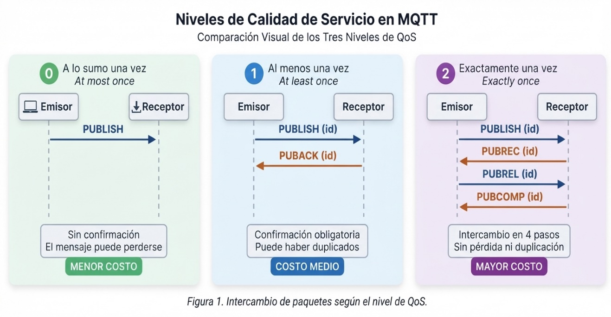

> Versión web del documento de Word «Marco teórico: estructura y desarrollo de un tema» (última modificación: 30/09/2026). Los índices con número de página se omitieron. Presenta la estructura del Capítulo II y desarrolla uno de sus temas (MQTT); el capítulo completo está en [Capítulo II](capitulo_2.md).

**UNIVERSIDAD CATÓLICA ANDRÉS BELLO**

Facultad de Ingeniería

Escuela de Ingeniería en Telecomunicaciones

# Marco teórico: estructura y desarrollo de un tema

Trabajo de Grado:

*“Robot móvil para búsqueda y transporte de componentes en el laboratorio de la UCAB con aplicación de solicitudes y alertas”*

**Norma de citación y referenciación: IEEE**

**REALIZADO POR:**

Semprun Cascitelli, Iliana Vanessa

Ferrer Pinto, Andrea Valentina

**TUTOR:**

Ing. Cante Mata, Biagio Domenico

Caracas, octubre de 2026

---

## Presentación

Este documento tiene dos partes. Primero, muestra cómo estará organizado el marco teórico (Capítulo II) de nuestro trabajo de grado sobre el robot móvil de la UCAB. Esta estructura la armamos basándonos en el mapa mental que hicimos y en los objetivos de la propuesta. Segundo, desarrolla uno de los temas de ese marco teórico: el protocolo MQTT (sección 2.2.7), incluyendo sus citas y la lista de referencias.

Elegimos usar la norma IEEE porque es la estándar en ingeniería eléctrica, electrónica y telecomunicaciones, y además mantiene la coherencia con la propuesta que ya habíamos escrito con ese mismo formato. Elegimos el tema MQTT porque es el corazón de la parte de telecomunicaciones del proyecto. Este tema nos ayuda directamente con el Objetivo Específico 1 (la arquitectura de comunicación MQTT) y se relaciona con el Objetivo 4 (el firmware del robot) y el Objetivo 8 (medir qué tan rápido y confiable es el sistema).

Para aplicar la norma IEEE, seguimos estas reglas:

- **Numeración:** Cada fuente que usamos recibe un número entre corchetes según el orden en que aparece por primera vez. Si la volvemos a mencionar, mantiene ese mismo número.

- **Detalles específicos:** Si citamos una parte exacta de un documento largo (como un estándar), ponemos la sección dentro del corchete: \[n, sec. x\]. Si citamos varias fuentes juntas, las separamos con comas \[n\], \[m\]. Si son tres o más seguidas, usamos un guion \[n\]–\[m\].

- **Formas de citar:** Podemos incluir la cita dentro de la oración con el apellido del autor (Ej: "Autor \[n\] compara...") o colocarla al final de la idea, justo antes del punto.

- **Lista de referencias:** Se ordena por número (no por orden alfabético) y lleva sangría francesa. Los títulos de artículos van entre comillas, mientras que los de libros, revistas o estándares van en cursiva. Si la fuente tiene DOI, lo ponemos, y si es de internet, agregamos la fecha en que la consultamos.

## PARTE I. ESTRUCTURA DEL MARCO TEÓRICO

En resumen, el Capítulo II de nuestro trabajo se divide en cuatro partes: antecedentes, bases teóricas, bases normativas y definición de términos. Dentro de las bases teóricas, explicamos todo el sistema del robot en el mismo orden en que lo vamos a construir, empezando desde la parte física (robótica móvil, sensores, control, localización, sistema embebido, redes inalámbricas, mensajería IoT, servicios en la nube, aplicación móvil y seguridad física) hasta llegar al usuario. Finalmente, el tema que estaba resaltado en el esquema es el que desarrollamos a fondo en la Parte II de este documento.

### CAPÍTULO II. MARCO TEÓRICO

- **2.1 Antecedentes de la investigación**
  - 2.1.1 Robots autónomos de reparto en entornos acotados
  - 2.1.2 Plataformas robóticas móviles de código abierto e imprimibles en 3D
  - 2.1.3 Evaluaciones de protocolos de mensajería para IoT
- **2.2 Bases teóricas**
  - 2.2.1 Robótica móvil
    - 2.2.1.1 Locomoción con ruedas y configuración de tracción diferencial
    - 2.2.1.2 Modelo cinemático del robot diferencial
  - 2.2.2 Sensores del robot
    - 2.2.2.1 Sensores ópticos reflectivos para el seguimiento de línea
    - 2.2.2.2 Medición de distancia por ultrasonido
    - 2.2.2.3 Unidad de medición inercial: acelerómetro y giroscopio
    - 2.2.2.4 Encoders incrementales
  - 2.2.3 Control de movimiento
    - 2.2.3.1 Seguimiento de línea
    - 2.2.3.2 Control proporcional-integral-derivativo (PID)
    - 2.2.3.3 Modulación por ancho de pulso (PWM) y accionamiento de motores DC
  - 2.2.4 Localización del robot
    - 2.2.4.1 Odometría y deriva acumulada
    - 2.2.4.2 Fusión de sensores: filtro complementario y filtro de Kalman
    - 2.2.4.3 Re-localización absoluta: balizas BLE (RSSI) y marcadores QR
  - 2.2.5 Sistemas embebidos: el SoC ESP32
  - 2.2.6 Redes inalámbricas de área local
    - 2.2.6.1 Estándar IEEE 802.11 (Wi-Fi)
    - 2.2.6.2 Bluetooth de baja energía (BLE)
    - 2.2.6.3 Propagación en interiores e intensidad de señal recibida (RSSI)
  - 2.2.7 Protocolo MQTT (tema desarrollado en la Parte II)
    - 2.2.7.1 Origen y evolución
    - 2.2.7.2 Paradigma de publicación/suscripción
    - 2.2.7.3 Arquitectura cliente–broker y paquetes de control
    - 2.2.7.4 Tópicos y filtros de tópicos
    - 2.2.7.5 Niveles de calidad de servicio (QoS)
    - 2.2.7.6 Sesión, mensajes retenidos, Keep Alive y mensaje de última voluntad
    - 2.2.7.7 Seguridad en MQTT
    - 2.2.7.8 MQTT frente a otros protocolos de mensajería IoT
    - 2.2.7.9 Aplicación del protocolo en el prototipo
  - 2.2.8 Servicios de backend en la nube
    - 2.2.8.1 Bases de datos en tiempo real
    - 2.2.8.2 Autenticación de usuarios
    - 2.2.8.3 Notificaciones push
  - 2.2.9 Desarrollo de aplicaciones móviles multiplataforma (Flutter)
  - 2.2.10 Detección de manipulación no autorizada con acelerómetro
    - 2.2.10.1 Definición de umbrales de detección
    - 2.2.10.2 Tasa de detección y tasa de falsas alarmas
  - 2.2.11 Fabricación aditiva: impresión 3D en PLA
  - 2.2.12 Métricas de desempeño del sistema: error de posición, latencia (RTT), fiabilidad y autonomía energética
- **2.3 Bases normativas y estándares técnicos**
  - 2.3.1 IEEE 802.11: redes inalámbricas de área local
  - 2.3.2 Especificación Bluetooth Core (BLE)
  - 2.3.3 MQTT: estándares OASIS v3.1.1 y v5.0, e ISO/IEC 20922:2016
  - 2.3.4 ISO/IEC 18004: símbolos de código QR
  - 2.3.5 TLS 1.3 (IETF RFC 8446)
- **2.4 Definición de términos básicos**

La tabla 1 muestra la correspondencia entre cada sección del marco teórico y los objetivos específicos (OE) de la propuesta, con el fin de verificar que todo contenido teórico sustente una parte concreta del proyecto.

**Tabla 1: Correspondencia entre las secciones del marco teórico y los objetivos específicos.**

| **Sección** | **Contenido que aporta al proyecto** | **OE** |
|---|---|---|
| **2.1 Antecedentes** | Estado del arte de robots de reparto, plataformas abiertas y evaluación de protocolos IoT; delimita el aporte del proyecto. | 1, 9 |
| **2.2.1 Robótica móvil** | Tracción diferencial y modelo cinemático para dimensionar el chasis y estimar la trayectoria. | 3, 5 |
| **2.2.2 Sensores** | Principio de funcionamiento de los sensores de línea, ultrasonido, IMU y encoders. | 2, 4 |
| **2.2.3 Control de movimiento** | Seguimiento de línea, control PID y accionamiento de motores por PWM. | 4 |
| **2.2.4 Localización** | Odometría, fusión de sensores y re-localización absoluta para acotar la deriva. | 5 |
| **2.2.5 ESP32** | Capacidades de procesamiento y conectividad del microcontrolador seleccionado. | 2, 4 |
| **2.2.6 Redes inalámbricas** | Medio de transporte de la mensajería (Wi-Fi) y base del posicionamiento por RSSI (BLE). | 1, 5 |
| **2.2.7 Protocolo MQTT** | Tópicos, niveles de QoS y flujos de mensajes para órdenes, estado y alertas. | 1, 4, 8 |
| **2.2.8 y 2.2.9 Backend y app** | Base de datos, autenticación, notificaciones push y desarrollo multiplataforma. | 6 |
| **2.2.10 Detección de manipulación** | Umbrales del acelerómetro y métricas de detección y falsas alarmas. | 7 |
| **2.2.11 Impresión 3D** | Fabricación aditiva del chasis en PLA. | 3 |
| **2.2.12 Métricas de desempeño** | Indicadores con los que se evaluará el prototipo en la maqueta. | 8 |
| **2.3 Bases normativas** | Estándares que rigen las tecnologías de comunicación y relocalización empleadas. | 1, 5 |
| **2.4 Términos básicos** | Glosario de conceptos técnicos del trabajo. | Todos |

**Nota:** La columna "OE" hace referencia a los Objetivos Específicos de la propuesta, donde el OE1 es la arquitectura de comunicación MQTT, el OE2 la selección de hardware, el OE3 la plataforma mecánica, el OE4 el firmware de control, el OE5 la navegación progresiva, el OE6 la aplicación y backend, el OE7 las alertas anti-manipulación, el OE8 la evaluación integral y el OE9 las limitaciones y mejoras futuras.

## PARTE II. DESARROLLO DEL TEMA: PROTOCOLO MQTT

### 2.2.7 Protocolo MQTT

MQTT (Message Queuing Telemetry Transport) es un protocolo que permite enviar mensajes entre un cliente y un servidor. Funciona con un modelo de publicación/suscripción, donde unos publican mensajes y otros se suscriben para recibirlos. Es un protocolo ligero, abierto, sencillo y fácil de implementar, lo que lo hace perfecto para entornos con recursos limitados, como la comunicación máquina a máquina (M2M) y la Internet de las Cosas (IoT), donde el ancho de banda es escaso o se necesita un código muy pequeño \[1\].

Funciona sobre TCP/IP o cualquier red que garantice conexiones ordenadas y sin pérdidas \[1\]. Dentro de la arquitectura de IoT, MQTT está en la capa de aplicación, donde comparte espacio con otros protocolos como CoAP, AMQP, XMPP y DDS, cada uno con sus propias ventajas según lo que se necesite \[2\].

<u>2.2.7.1 Origen y evolución</u>

MQTT fue creado y liberado como un protocolo abierto por IBM \[3\]. Su primera versión es de 1999. En 2010 se publicó libre de regalías y en 2013 se entregó al comité de normalización OASIS, que aprobó la versión 3.1.1 como estándar en 2014. En 2016, esa misma versión se convirtió en norma ISO y, finalmente, en 2019 se estandarizó la versión 5.0 \[4\]. La versión 3.1.1 fue la primera en publicarse como estándar de OASIS \[5\] y también se editó como norma ISO/IEC 20922:2016 \[1, sec. 1.8.1\], \[6\].

La versión 5.0 mantiene la esencia del protocolo, pero añade mejoras para sistemas grandes: reportes de errores más detallados (códigos de motivo), patrones de solicitud/respuesta, propiedades de usuario y mejor rendimiento para dispositivos pequeños \[1, sec. 1.8.2\]. Como es la versión actual, será la que usemos como referencia principal en este trabajo; por lo tanto, las secciones que citemos de aquí en adelante corresponden a esta versión.

<u>2.2.7.2 Paradigma de publicación/suscripción</u>

En este modelo, los suscriptores expresan su interés por recibir cierto tipo de eventos y son notificados de forma automática (asíncrona) cuando los publicadores generan eventos que coinciden con esa búsqueda \[7\]. Eugster et al. \[7\] señalan que la característica principal de todas las variantes de este paradigma es la independencia total entre quienes publican y quienes reciben los mensajes. Esta independencia ocurre en tres niveles:

- **Espacio:** Los publicadores y suscriptores no necesitan conocerse ni saber cuántos son.

- **Tiempo:** No necesitan estar conectados al mismo tiempo.

- **Sincronización:** El publicador no se queda bloqueado esperando a que el otro reciba el mensaje; el suscriptor lo recibe mientras hace otras tareas.

En MQTT, esta independencia la logra un intermediario llamado **broker** (el servidor). El broker recibe los mensajes y los reparte a los suscriptores cuyas búsquedas coinciden \[1, sec. 1.2\]. Sin embargo, la independencia en el tiempo es parcial: si un suscriptor está desconectado, solo recibirá los mensajes que se perdió si mantiene una sesión persistente o si el mensaje fue publicado como retenido (sección 2.2.7.6).

La consecuencia práctica más importante de este modelo es la **escalabilidad**: se pueden añadir nuevos suscriptores (como un sistema de registro o una segunda aplicación) sin necesidad de modificar el código de los publicadores originales.

<u>2.2.7.3 Arquitectura cliente-broker y paquetes de control</u>

MQTT define dos roles principales \[1, sec. 1.2\]:

- **Cliente:** Es el programa o dispositivo que usa MQTT (como el robot o la app). Se encarga de conectarse a la red, publicar mensajes, suscribirse para recibir los que le interesan, cancelar suscripciones y desconectarse.

- **Servidor (broker):** Es el intermediario. Acepta las conexiones de los clientes, recibe los mensajes publicados, gestiona las solicitudes de suscripción y reenvía los mensajes a los clientes que coincidan con ellas.

La comunicación se hace mediante paquetes de control. La versión 5.0 define 15 tipos (como CONNECT, PUBLISH, SUBSCRIBE, DISCONNECT y AUTH). Cada paquete tiene hasta tres partes: una cabecera fija (mínimo 2 bytes), una cabecera variable (opcional) y una carga útil (payload) \[1, sec. 2.1\]. El protocolo no se fija en el contenido del payload \[1\], así que puede transportar texto, JSON o datos binarios sin problema.

Entre los brokers de código abierto más usados está Eclipse Mosquitto \[8\], que incluye el servidor, librerías para programar y herramientas de línea de comandos para publicar y suscribirse.

<u>2.2.7.4 Tópicos y filtros de tópicos</u>

Cada mensaje se publica con un "nombre de tópico" (topic name), una cadena de texto que el broker compara con las suscripciones registradas \[1, sec. 1.2\]. Los tópicos tienen estructura de árbol, donde el carácter "/" separa los niveles, por ejemplo: ucab/robot/estado \[1, sec. 4.7\].

Para suscribirse, se usan "filtros de tópicos", que pueden incluir dos comodines \[1, sec. 4.7.1\]:

- **Comodín multinivel "#":** Coincide con el nivel padre y cualquier número de niveles inferiores. Debe ser el último carácter del filtro. Por ejemplo, ucab/robot/# recibe todos los mensajes del robot.

- **Comodín de un nivel "+":** Coincide con exactamente un nivel. Por ejemplo, ucab/+/alertas recibiría las alertas de cualquier robot si el sistema creciera a varias unidades.

Por último, existe una regla especial para los tópicos que comienzan con el símbolo “\$”. Estos tópicos están reservados exclusivamente para que el servidor (broker) publique información sobre su propio estado interno, y no para que los clientes los usen \[1, sec. 4.7.2\]. Por esta razón, si un cliente crea un filtro que empieza con un comodín (como \# o +), ese filtro no coincidirá con los tópicos que comienzan con \$. Un ejemplo muy común es el prefijo \$SYS, que los brokers utilizan para publicar datos específicos del servidor, como estadísticas de conexión o uso de memoria \[1, sec. 4.7.2\].

<u>2.2.7.5 Niveles de calidad de servicio (QoS)</u>

MQTT ofrece tres niveles de calidad de servicio (QoS) para entregar los mensajes. Cada nivel representa un equilibrio distinto entre la fiabilidad (que el mensaje llegue seguro) y el costo (recursos y tiempo que consume) \[1, sec. 4.3\].

- **<u>QoS 0, “a lo sumo una vez” (at most once):</u>** El mensaje se envía una sola vez, sin confirmación de que haya llegado. El emisor manda un PUBLISH, el receptor no responde nada y el mensaje puede perderse \[1, sec. 4.3.1\]. Se recomienda para datos de sensores que se envían periódicamente, donde perder una lectura no es grave porque la siguiente se enviará poco después \[1\].

- **<u>QoS 1, “al menos una vez” (at least once):</u>** Aquí se garantiza que el mensaje llegue, pero puede duplicarse. El PUBLISH lleva un identificador y el receptor responde con un PUBACK. El emisor espera esa confirmación y, si la conexión se interrumpe, reenvía el mensaje cuando se restablece la sesión, activando el indicador DUP \[1, secs. 4.3.2 y 4.4\]. Por eso, la aplicación que recibe debe estar preparada para tolerar mensajes duplicados.

- **<u>QoS 2, “exactamente una vez” (exactly once):</u>** Es el nivel más alto y se usa cuando ni la pérdida ni la duplicación son aceptables. La entrega se completa en cuatro pasos: el emisor envía PUBLISH, el receptor responde PUBREC (publicación recibida), el emisor contesta PUBREL (liberación) y el receptor cierra con PUBCOMP (publicación completa) \[1, sec. 4.3.3\]. La especificación lo ejemplifica con sistemas de facturación, donde un mensaje perdido o duplicado podría generar cobros incorrectos \[1\].

La Figura 1 compara los tres flujos y la Tabla 2 resume sus características.

Figura 1. Intercambio de paquetes según el nivel de QoS. Fuente: elaboración propia a partir de \[1, sec. 4.3\].

El nivel de QoS se aplica por tramo. Esto significa que entre el publicador y el broker se usa el nivel con el que se publica el mensaje; pero entre el broker y cada suscriptor, el mensaje se entrega con el menor valor entre el QoS original y el QoS máximo permitido en esa suscripción \[1, sec. 3.8.4\]. Por lo tanto, para que una alerta viaje con QoS 2 de extremo a extremo (desde el robot hasta la aplicación), tanto la publicación como la suscripción deben declararse con ese mismo nivel.

Ahora bien, elevar el QoS tiene un costo. Lee et al. \[3\] analizaron la transmisión de mensajes MQTT entre un publicador, un broker y un suscriptor reales, tanto en redes cableadas como inalámbricas. Variaron el nivel de QoS y el tamaño de la carga útil, y midieron el retardo extremo a extremo y la pérdida de mensajes. Sus resultados muestran que, a mayor nivel de QoS, más paquetes se intercambian: un QoS alto es más eficaz para evitar pérdidas, pero el proceso más complejo incrementa el retardo extremo a extremo \[3\]. Por tanto, el QoS debe elegirse para cada flujo de mensajes según su criticidad, y no de forma uniforme para todos.

**Tabla 2. Características de los niveles de QoS en MQTT**

| **Nivel** | **Garantía de entrega** | **Paquetes por entrega** | **Riesgo o costo** | **Uso típico** |
|---|---|---|---|---|
| 0 | A lo sumo una vez | 1 (PUBLISH) | Pérdida del mensaje | Telemetría periódica |
| 1 | Al menos una vez | 2 (PUBLISH, PUBACK) | Duplicación | Órdenes o comandos que toleran repetición |
| 2 | Exactamente una vez | 4 (PUBLISH, PUBREC, PUBREL, PUBCOMP) | Mayor latencia y sobrecarga | Eventos críticos que no deben perderse ni repetirse |

*Fuente: elaboración propia a partir de \[1\] y \[3\].*

<u>2.2.7.6 Sesión, mensajes retenidos, Keep Alive y mensaje de última voluntad</u>

- **<u>Sesión.</u>** Es la interacción con estado entre un cliente y el servidor. Algunas sesiones duran solo lo que dura la conexión de red, mientras que otras pueden abarcar varias conexiones consecutivas \[1, sec. 1.2\]. Al conectarse, el cliente usa el indicador Clean Start para decidir si inicia una sesión nueva o continúa una existente, y con la propiedad Session Expiry Interval define cuánto tiempo debe conservarse el estado después de desconectarse \[1, secs. 3.1.2.4 y 3.1.2.11.2\]. El estado que guarda el servidor incluye, entre otras cosas, las suscripciones del cliente y los mensajes de QoS 1 y QoS 2 que estén pendientes de entrega o confirmación \[1, sec. 4.1\]. La especificación señala que un cliente con conectividad intermitente (por ejemplo, un robot que sale del alcance del Wi-Fi) puede aprovechar este intervalo para reconectarse cuando la red vuelva a estar disponible y continuar recibiendo sus mensajes sin perderlos \[1, sec. 3.1.2.11.2\].

- **<u>Mensajes retenidos.</u>** Si un PUBLISH llega al servidor con el indicador RETAIN activado (en 1), el servidor guarda ese mensaje como el último valor válido para ese tópico, reemplazando al anterior \[1, sec. 3.3.1.3\]. Gracias a esto, cuando un nuevo cliente se suscribe a ese tópico, recibe de inmediato el último valor conocido, sin tener que esperar a que se publique el siguiente.

- **<u>Keep Alive.</u>** Es el intervalo máximo de tiempo (en segundos) que puede pasar entre dos paquetes de control enviados por el cliente. Si el cliente no tiene datos que enviar, manda un paquete PINGREQ, y el servidor le responde con PINGRESP. Si el servidor no recibe ningún paquete en un tiempo equivalente a una vez y media el valor de Keep Alive, cierra la conexión como si la red hubiera fallado \[1, sec. 3.1.2.10\]. Este mecanismo permite detectar rápidamente si un cliente (como el robot) se desconectó, incluso cuando la capa de red no lo notifica.

- **<u>Mensaje de última voluntad (Will Message).</u>** Al conectarse, el cliente puede registrar en el servidor un mensaje de "última voluntad", indicando su tópico, su contenido y su nivel de QoS. El servidor publicará este mensaje automáticamente si la conexión se cierra de forma anómala, por ejemplo: por un error de entrada/salida, por una falla de red, porque el cliente no se comunicó dentro del plazo de Keep Alive, o porque cerró la conexión sin enviar un DISCONNECT normal. Si el cliente se desconecta correctamente, el mensaje se elimina y no se publica \[1, sec. 3.1.2.5\]. La versión 5.0 añade además la propiedad Will Delay Interval, que retrasa la publicación del mensaje para no generar falsas alarmas ante desconexiones breves de las que el cliente se recupera solo \[1, sec. 3.1.3.2.2\].

<u>2.2.7.7 Seguridad en MQTT</u>

La especificación recomienda que tanto los clientes como los servidores implementen mecanismos de autenticación, autorización y comunicación segura, y aconseja enfáticamente su uso cuando se maneja infraestructura crítica o información sensible \[1, sec. 1.6\]. Su capítulo de seguridad (que no es obligatorio, sino una guía) aborda tres temas: cómo el servidor autentica al cliente y viceversa, cómo se autoriza el acceso a los recursos del servidor, y cómo se garantiza la integridad y privacidad de los mensajes \[1, sec. 5.4\]. Para este proyecto, hay tres mecanismos que resultan especialmente relevantes:

- **<u>Autenticación:</u>** El paquete CONNECT puede incluir un nombre de usuario y una contraseña \[1, secs. 3.1.3.5 y 3.1.3.6\]. La versión 5.0 añade además la autenticación extendida mediante el paquete AUTH, que permite esquemas más complejos de desafío-respuesta \[1, sec. 4.12\].

- **<u>Autorización:</u>** Una vez que el cliente se ha autenticado, el servidor puede verificar si tiene permiso para acceder a ciertos recursos (como tópicos específicos) y restringir su acceso según la información que el cliente haya aportado \[1, sec. 5.4.2\].

- **<u>Cifrado:</u>** La confidencialidad e integridad de los mensajes se logran transportando MQTT sobre TLS \[1, sec. 5.4\]. Este protocolo, en su versión 1.3, permite que cliente y servidor se comuniquen por Internet con protección frente a la escucha, la manipulación y la falsificación de mensajes \[9\].

La IANA tiene registrados dos puertos TCP para MQTT: el 1883 para MQTT sin TLS y el 8883 para MQTT sobre TLS \[1, sec. 4.2\], \[10\]. Sin embargo, el cifrado tiene un costo: TLS incrementa el uso de CPU y la sobrecarga de comunicación \[10\], un aspecto que debe considerarse especialmente en microcontroladores con recursos limitados como el ESP32.

<u>2.2.7.8 MQTT frente a otros protocolos de mensajería IoT</u>

Naik \[11\] compara MQTT, CoAP, AMQP y HTTP usando criterios como el tamaño y la sobrecarga de los mensajes, el consumo de energía, el ancho de banda, la latencia, la fiabilidad, la interoperabilidad y la seguridad. Su conclusión es que ningún protocolo cumple con todos los requisitos de todos los sistemas IoT, por lo que la elección depende de la naturaleza de cada proyecto. De los cuatro, el más parecido a MQTT en su propósito es CoAP: un protocolo web especializado para nodos y redes restringidas, basado en el modelo solicitud/respuesta de REST sobre UDP, con mensajes confirmables y no confirmables y una cabecera fija de solo 4 bytes \[12\]. La Tabla 3 resume las diferencias principales.

**Tabla 3. Comparación de MQTT con otros protocolos de mensajería para IoT.**

| **Característica** | **MQTT** | **CoAP** | **AMQP** | **HTTP** |
|---|---|---|---|---|
| Transporte | TCP | UDP | TCP | TCP |
| Patrón de comunicación | Publicación/suscripción mediante broker | Solicitud/respuesta (REST) | Publicación/suscripción y colas punto a punto | Solicitud/respuesta (REST) |
| Cabecera mínima | 2 bytes | 4 bytes | 8 bytes | Variable (texto) |
| Fiabilidad de entrega | Tres niveles de QoS | Mensajes confirmables y no confirmables | Entrega con y sin confirmación | Delegada en TCP |
| Normalización | OASIS; ISO/IEC | IETF | OASIS; ISO/IEC | IETF |
| *Fuente: elaboración propia a partir de \[1\], \[11\] y \[12\].* |  |  |  |  |

Para nuestro prototipo, MQTT resulta el más adecuado por tres razones. Primero, su patrón de publicación/suscripción permite que el robot y la aplicación se comuniquen sin conocerse entre sí, y que se agreguen nuevos consumidores (como el backend de trazabilidad) sin modificar el firmware \[7\]. Segundo, sus tres niveles de QoS permiten asignar a cada flujo la fiabilidad que realmente necesita \[1\]. Y tercero, la conexión TCP persistente, junto con el Keep Alive y el mensaje de última voluntad, facilita detectar rápidamente si el robot se desconectó \[1\]. En cambio, CoAP sería preferible en redes de muy bajo consumo y con muchas pérdidas, y HTTP sería mejor para interacciones puntuales de solicitud/respuesta, como las consultas que hace la aplicación al backend.

<u>2.2.7.9 Aplicación del protocolo en el prototipo</u>

El robot, que funciona con un microcontrolador ESP32 (un SoC que integra Wi-Fi IEEE 802.11 b/g/n en 2,4 GHz y Bluetooth v4.2 BR/EDR y BLE \[13\]), y la aplicación móvil desarrollada en Flutter actúan como clientes MQTT de un broker central. Este broker puede ser HiveMQ Cloud o una instancia local de Mosquitto \[8\]. La Tabla 4 resume los tópicos definidos en la propuesta y por qué se eligió ese nivel de QoS para cada uno.

**Tabla 4. Tópicos del prototipo y justificación del nivel de QoS.**

| **Tópico** | **Publicador → suscriptor** | **QoS** | **Justificación** |
|---|---|---|---|
| ucab/robot/estado | Robot → aplicación | 0 | Telemetría periódica y redundante: si se pierde una muestra, la siguiente la reemplaza \[1\]. Si se publica como mensaje retenido, la aplicación muestra de inmediato el último estado conocido \[1, sec. 3.3.1.3\]. |
| ucab/robot/ordenes | Aplicación → robot | 1 | La orden debe llegar; un posible duplicado puede descartarse en el firmware mediante un identificador único de solicitud \[1, sec. 4.3.2\]. |
| ucab/robot/alertas | Robot → aplicación | 2 | Una alerta de manipulación no debe perderse ni duplicarse \[1, sec. 4.3.3\]. |

*Fuente: elaboración propia a partir de la propuesta del Trabajo de Grado y de \[1\].*

A estos tópicos se suman los mecanismos que ya explicamos en la sección 2.2.7.6. Por un lado, el mensaje de última voluntad permite avisar a la aplicación si el robot pierde la conexión, por ejemplo cuando sale del alcance del Wi-Fi, y el valor de *Keep Alive* define el tiempo máximo para detectar esa desconexión \[1, secs. 3.1.2.5 y 3.1.2.10\]. Por otro lado, si el broker se aloja en la nube, la conexión debe hacerse sobre TLS por el puerto 8883 y con credenciales propias para cada cliente \[1, sec. 5.4\], \[10\]. Además, las alertas pueden complementarse con notificaciones push de Firebase Cloud Messaging, para que el usuario las reciba incluso cuando la aplicación no está abierta en primer plano \[14\].

Finalmente, como ya vimos, un QoS más alto implica más paquetes y mayor retardo \[3\]. Por eso, la evaluación del sistema (OE8) medirá el tiempo de ida y vuelta (RTT) de los mensajes separándolos por nivel de QoS. De esta forma, se podrá comprobar experimentalmente, en la red del laboratorio, el equilibrio entre fiabilidad y latencia que hemos descrito en esta sección.

## REFERENCIAS

\[1\] A. Banks, E. Briggs, K. Borgendale y R. Gupta, Eds., MQTT Version 5.0, OASIS Standard, 7 mar. 2019. Accedido: 28 sep. 2026. \[En línea\]. Disponible: https://docs.oasis-open.org/mqtt/mqtt/v5.0/os/mqtt-v5.0-os.html

\[2\] A. Al-Fuqaha, M. Guizani, M. Mohammadi, M. Aledhari y M. Ayyash, “Internet of Things: A survey on enabling technologies, protocols, and applications,” IEEE Commun. Surveys Tuts., vol. 17, n.º 4, pp. 2347–2376, 2015, doi: 10.1109/COMST.2015.2444095.

\[3\] S. Lee, H. Kim, D.-K. Hong y H. Ju, “Correlation analysis of MQTT loss and delay according to QoS level,” en Proc. Int. Conf. Inf. Netw. (ICOIN), 2013, pp. 714–717, doi: 10.1109/ICOIN.2013.6496715.

\[4\] B. Mishra y A. Kertesz, “The use of MQTT in M2M and IoT systems: A survey,” IEEE Access, vol. 8, pp. 201071–201086, 2020, doi: 10.1109/ACCESS.2020.3035849.

\[5\] A. Banks y R. Gupta, Eds., MQTT Version 3.1.1, OASIS Standard, 29 oct. 2014. Accedido: 28 sep. 2026. \[En línea\]. Disponible: http://docs.oasis-open.org/mqtt/mqtt/v3.1.1/os/mqtt-v3.1.1-os.html

\[6\] Information Technology—Message Queuing Telemetry Transport (MQTT) v3.1.1, ISO/IEC 20922:2016, 2016.

\[7\] P. Th. Eugster, P. A. Felber, R. Guerraoui y A.-M. Kermarrec, “The many faces of publish/subscribe,” ACM Comput. Surv., vol. 35, n.º 2, pp. 114–131, jun. 2003, doi: 10.1145/857076.857078.

\[8\] R. A. Light, “Mosquitto: server and client implementation of the MQTT protocol,” J. Open Source Softw., vol. 2, n.º 13, art. 265, 2017, doi: 10.21105/joss.00265.

\[9\] E. Rescorla, “The Transport Layer Security (TLS) protocol version 1.3,” IETF, RFC 8446, ago. 2018, doi: 10.17487/RFC8446.

\[10\] HiveMQ, “TLS/SSL – MQTT security fundamentals,” HiveMQ Blog. Accedido: 28 sep. 2026. \[En línea\]. Disponible: https://www.hivemq.com/blog/mqtt-security-fundamentals-tls-ssl/

\[11\] N. Naik, “Choice of effective messaging protocols for IoT systems: MQTT, CoAP, AMQP and HTTP,” en Proc. IEEE Int. Syst. Eng. Symp. (ISSE), Viena, Austria, 2017, pp. 1–7, doi: 10.1109/SysEng.2017.8088251.

\[12\] Z. Shelby, K. Hartke y C. Bormann, “The Constrained Application Protocol (CoAP),” IETF, RFC 7252, jun. 2014, doi: 10.17487/RFC7252.

\[13\] Espressif Systems, ESP32 Series Datasheet. Accedido: 28 sep. 2026. \[En línea\]. Disponible: https://www.espressif.com/sites/default/files/documentation/esp32_datasheet_en.pdf

\[14\] Google, “Firebase Cloud Messaging,” Firebase Documentation. Accedido: 28 sep. 2026. \[En línea\]. Disponible: https://firebase.google.com/docs/cloud-messaging
